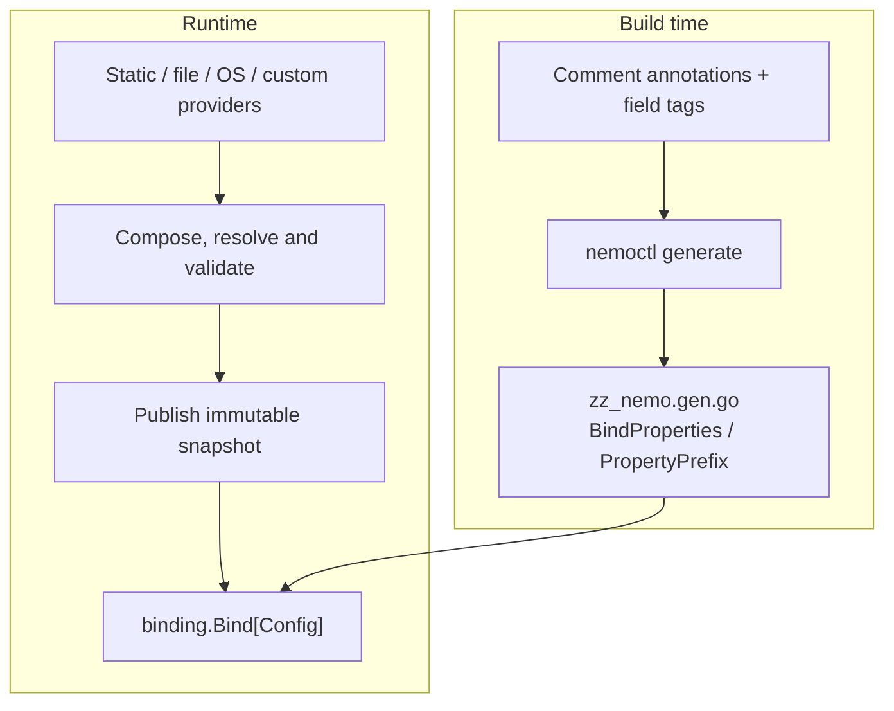

# nemo

[English](README.md) | [简体中文](README.zh_CN.md) | [Online manual](https://longxi-go.github.io/nemo/)

nemo is a Go configuration library that uses comment annotations to generate
typed binding methods. It implements the
[gosr environment contracts](https://longxi-go.github.io/gosr/contracts/environment/).
It loads explicit sources, resolves configuration into immutable snapshots and
binds those snapshots to Go types through generated methods.

Requires **Go 1.27.0 or later**.



## Install and use

Add the library to an application module and install the generator:

```sh
go get github.com/longxi-go/nemo
go install github.com/longxi-go/nemo/cmd/nemoctl@latest
```

Ensure the Go binary directory is on `PATH`. For reproducible builds, select the
same nemo module version for the application and `nemoctl`.

## Comment annotations

Nemo defines one type annotation:

| Annotation | Placement | Effect |
| --- | --- | --- |
| `// +nemo:config:prefix=app` | Immediately above a named configuration struct | Generate binding methods with `app` as the default binding prefix |

Prefixes support multiple levels, such as
`// +nemo:config:prefix=company.platform.payment.database`.
See the [multi-level prefix example](docs/design/docs/annotations.md#multi-level-prefixes)
for the corresponding YAML and property keys.

`property`, `default` and `required` are Go field tags parsed by the generator.
Declare the annotation and tags in source:

```go
// +nemo:config:prefix=app
type Config struct {
    Name string `required:"true"`
    Port int    `default:"8080"`
}
```

Run from the application module:

```sh
nemoctl generate --roots ./...
nemoctl check --roots ./...
```

Bind with `binding.Bind[Config](snapshot, "")`; the empty prefix selects `app`
from the annotation. The
[quick start](docs/design/docs/quick-start.md) provides a complete program;
[examples/config](examples/config) includes durations and nested configuration.
The [annotation guide](docs/design/docs/annotations.md) lists the supported syntax,
tag rules, prefix selection and `go:generate` usage.
The [generator guide](docs/design/docs/generation.md) covers package selection,
output ownership and freshness checks.

## Configuration semantics

- Providers are ordered from highest to lowest precedence. The first provider
  containing an exact key supplies its value, including empty strings and null.
  Errors do not fall through to lower sources.
- YAML/YML, JSON and TOML preserve native scalar types. Java properties and INI
  preserve strings. Objects normalize into dotted addresses; lists retain typed values.
- Placeholders support `${key}`, `${key:default}`, recursive references, nested
  defaults and escaped literals. Defaults apply only to missing keys. Cycles,
  malformed syntax and resource limits are errors.
- `environment.New` loads revision 1. `Refresh` prepares and validates a full
  candidate before publication; a preparation failure preserves the previous
  snapshot. Equal values and origins do not create a new revision.
- Capture one snapshot for related reads. Optional notifications run after commit,
  outside the refresh gate; `NotificationError` means publication succeeded and
  notification failed. `Watch` blocks within its caller's context and joins its
  provider loops and refresh worker before returning.
- Generated binding supports anonymous nested objects, object collections and
  bounded recursion using typed operations without runtime reflection or unsafe.
  Failed binding preserves the target. `binding.Bind[Config](snapshot, "")` uses
  the annotation prefix; a direct `BindProperties(snapshot, "")` call uses the root.

See [configuration](docs/design/docs/configuration.md),
[binding](docs/design/docs/binding.md) and
[architecture](docs/design/docs/architecture.md) for constraints and extension contracts.

## Packages and extensions

| Package | Responsibility |
| --- | --- |
| `pkg/source` | Immutable raw sources, static/file/OS providers and explicit file discovery |
| `pkg/codec` | Built-in/custom document decoders and immutable application registries |
| `pkg/environment` | Composition, profiles, snapshots, refresh, watch and notifications |
| `pkg/binding` | Typed conversion and binding through compile-time interface constraints |
| `pkg/limits` | Document, source and candidate resource limits |
| `pkg/maptypes` | Generic keyed map aliases and configuration value/property maps |
| `pkg/codegen` | Generation, inspection and freshness-check API |
| `internal` | Normalization, resolution, annotation compiler and CLI implementation |
| `cmd/nemoctl` | Generator command entry point |

Custom configuration-center adapters implement `source.Provider` and optionally
`source.Watcher`. They own clients, subscription lifetime, resynchronization,
freshness and cache fallback. Invalidations use the same validated refresh path.
Configuration updates do not provide distributed transactions or automatically rebuild application
components. Planned adapters and framework integration are listed in the
[roadmap](docs/roadmap.md).

## Documentation and contribution

- [English manual](https://longxi-go.github.io/nemo/) · [Simplified Chinese manual](https://longxi-go.github.io/nemo/zh/)
- [Development guide](docs/design/docs/development.md)
- [Documentation maintenance](docs/design/README.md)
- [Maintainer release guide](docs/maintainers/releases.md)
- [Release history](https://github.com/longxi-go/nemo/releases)
