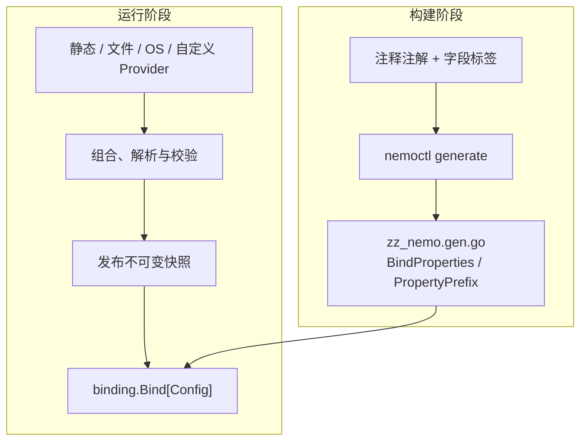

# nemo

[English](README.md) | [简体中文](README.zh_CN.md) | [在线手册](https://longxi-go.github.io/nemo/zh/)

nemo 是通过注释注解生成类型化绑定方法的 Go 配置组件，实现
[gosr 环境契约](https://longxi-go.github.io/gosr/zh/contracts/environment/)。
它从显式指定的配置源加载数据，解析为不可变快照，并通过生成的方法绑定到 Go 类型。

要求 **Go 1.27.0 或更高版本**。



## 安装与使用

在应用模块中添加库并安装生成器：

```sh
go get github.com/longxi-go/nemo
go install github.com/longxi-go/nemo/cmd/nemoctl@latest
```

将 Go 可执行文件目录加入 `PATH`。应用依赖与 `nemoctl` 应固定为相同的 nemo 模块版本，以便复现构建结果。

## 注释注解

Nemo 定义一种类型注解：

| 注解 | 位置 | 作用 |
| --- | --- | --- |
| `// +nemo:config:prefix=app` | 命名配置结构体声明的正上方 | 生成绑定方法，并以 `app` 作为默认绑定前缀 |

前缀支持多层路径，例如 `// +nemo:config:prefix=company.platform.payment.database`。
对应的 YAML 和完整属性键见[多层前缀示例](docs/design/docs/annotations.zh.md#multi-level-prefixes)。

`property`、`default`、`required` 是生成器读取的 Go 字段标签。
在源码中声明注解和标签：

```go
// +nemo:config:prefix=app
type Config struct {
    Name string `required:"true"`
    Port int    `default:"8080"`
}
```

在应用模块内运行：

```sh
nemoctl generate --roots ./...
nemoctl check --roots ./...
```

通过 `binding.Bind[Config](snapshot, "")` 绑定配置；空前缀采用注解中的 `app`。
[快速开始](docs/design/docs/quick-start.zh.md)提供完整程序；
[examples/config](examples/config)还包含时长和嵌套配置。
[注释注解指南](docs/design/docs/annotations.zh.md)列出支持的语法、标签规则、前缀选择和 `go:generate` 用法。
[生成器指南](docs/design/docs/generation.zh.md)说明包选择、输出所有权和生成文件一致性检查。

## 配置语义

- Provider 按优先级从高到低排列。每个精确键采用首个包含它的 Provider 所提供的值，包括空字符串和 null；错误不会回退到低优先级来源。
- YAML/YML、JSON 和 TOML 保留原生标量类型；Java properties 和 INI 保留字符串。
  对象规范化为点分地址，列表保留类型化值。
- 占位符支持 `${key}`、`${key:default}`、递归引用、嵌套默认值和转义字面量。
  默认值只适用于缺失键。循环引用、语法错误和超出资源限制均产生错误。
- `environment.New` 加载修订号为 1 的快照。`Refresh` 在发布前完整准备并验证候选快照；准备失败保留原快照。
  值和来源信息均相同时不会递增修订号。
- 关联读取应获取同一快照。可选通知在提交后、刷新互斥区外执行；`NotificationError` 表示发布成功而通知失败。
  `Watch` 在调用方 context 内阻塞，返回前等待所有 Provider 循环及刷新任务结束。
- 生成式绑定支持匿名嵌套对象、对象集合及有界递归，使用类型化操作，不使用运行时反射或 unsafe。绑定失败保留目标原值。
  `binding.Bind[Config](snapshot, "")` 使用注解前缀；直接调用 `BindProperties(snapshot, "")` 则绑定根路径。

约束和扩展契约见[配置语义](docs/design/docs/configuration.zh.md)、
[类型化绑定](docs/design/docs/binding.zh.md)和[架构](docs/design/docs/architecture.zh.md)。

## 包与扩展

| 包 | 职责 |
| --- | --- |
| `pkg/source` | 不可变原始属性源，静态/文件/OS Provider 及显式文件发现 |
| `pkg/codec` | 内置/自定义文档解码器及应用级只读注册表 |
| `pkg/environment` | 组合、Profile、快照、刷新、监听和通知 |
| `pkg/binding` | 类型转换与编译期绑定接口约束 |
| `pkg/limits` | 文档、配置源及候选快照的资源限制 |
| `pkg/maptypes` | 泛型 map 别名及配置值、属性映射 |
| `pkg/codegen` | 代码生成、输出报告及生成文件一致性检查 API |
| `internal` | 规范化、解析、注解编译器和 CLI 实现 |
| `cmd/nemoctl` | 生成器命令入口 |

自定义配置中心适配器实现 `source.Provider`，并可选择实现 `source.Watcher`。
适配器负责客户端、订阅生命周期、重新同步、数据时效性和缓存回退，失效通知通过刷新流程触发候选快照校验与发布。
配置更新不提供分布式事务，也不会自动重建应用组件。
适配器及框架集成计划见[路线图](docs/roadmap.zh_CN.md)。

## 文档与贡献

- [英文手册](https://longxi-go.github.io/nemo/) · [简体中文手册](https://longxi-go.github.io/nemo/zh/)
- [开发指南](docs/design/docs/development.zh.md)
- [文档维护](docs/design/README.zh.md)
- [维护者发布指南](docs/maintainers/releases.zh_CN.md)
- [发布记录](https://github.com/longxi-go/nemo/releases)
