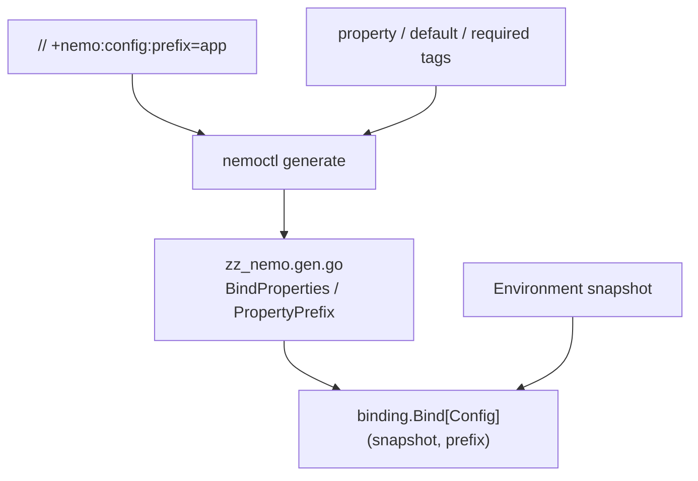

# Comment annotations

Nemo uses the controller-tools marker syntax to select configuration types for
code generation. `nemoctl` reads these comments and Go field tags before the
application runs. Runtime binding calls the generated Go methods.



## Supported annotations {#annotations}

| Annotation | Target | Argument | Generated methods |
| --- | --- | --- | --- |
| `+nemo:config:prefix=<prefix>` | Named, non-generic struct declaration | String; a nonempty value must be a valid gosr property key | `BindProperties` and `PropertyPrefix` |

This is the only Nemo comment annotation. Place it in the type's documentation
comment, directly above the declaration:

```go
// +nemo:config:prefix=app
type Config struct {
    Name     string   `property:"name" required:"true"`
    Port     int      `property:"http.port" default:"8080"`
    Database Database `property:"database"`
    Local    string   `property:"-"`
}

type Database struct {
    Host string `property:"host" default:"localhost"`
}
```

`Name` binds `app.name`, `Port` binds `app.http.port`, and `Database.Host` binds
`app.database.host`. The generator includes local nested structs without requiring
an annotation on each nested type. `Local` is skipped and retains its existing
value when binding an existing target.

Use an explicitly empty argument to generate a binder whose default prefix is
the root:

```go
// +nemo:config:prefix=""
```

## Multi-level prefixes {#multi-level-prefixes}

A prefix can contain multiple dotted segments. The following declaration binds a
flat Go struct to configuration under `company.platform.payment.database`:

```go
// +nemo:config:prefix=company.platform.payment.database
type DatabaseConfig struct {
    Host string `property:"host" required:"true"`
    Port int    `property:"port" default:"5432"`
}
```

Corresponding YAML:

```yaml
company:
  platform:
    payment:
      database:
        host: db.internal
        port: 6432
```

| Field | Full property key | Bound value |
| --- | --- | --- |
| `Host` | `company.platform.payment.database.host` | `"db.internal"` |
| `Port` | `company.platform.payment.database.port` | `6432` |

After generation, `binding.Bind[DatabaseConfig](snapshot, "")` uses the annotated
prefix. The Go struct does not need fields for the `company`, `platform` or
`payment` levels. Field tags remain relative to the selected prefix.

An explicit prefix can also have multiple levels:
`binding.Bind[DatabaseConfig](snapshot, "tenant.eu.payment.database")` reads
`tenant.eu.payment.database.host` and `tenant.eu.payment.database.port`.
Prefixes match exact addresses; `...` has no wildcard or abbreviation meaning.

## Field tags {#field-tags}

Field tags configure the generated binder; they are Go struct tags rather than
comment annotations. The type annotation requests binding methods; field tags
alone do not generate methods for a type.

| Tag | Effect |
| --- | --- |
| No `property` tag | Lowercase the complete Go field name; `DatabaseURL` maps to `databaseurl` |
| `property:"http.port"` | Use this relative property key under the binding prefix |
| `property:"-"` | Exclude the field from binding and preserve its value |
| `default:"8080"` | Decode the string when the property is missing |
| `required:"true"` | Fail when neither a property nor a default supplies the field |

`required` accepts only `true` or `false`. Defaults apply to scalar fields and
scalar lists; they do not replace empty strings, null or invalid input. Unexported
fields must use `property:"-"`. Conversion rules, nested-object behavior and
supported field types are specified in [typed binding](binding.md).

## Generate and bind {#generate-and-bind}

After installing `nemoctl` as described in [quick start](quick-start.md), run it
from the application module:

```sh
nemoctl generate --roots ./...
nemoctl check --roots ./...
```

Each selected package with annotated types receives a `zz_nemo.gen.go` file.
Commit that file with its configuration declarations. Dependencies publish their
own generated methods; application generation does not write into dependencies
or the module cache.

Given a captured environment snapshot, choose the prefix at the binding call:

| Call | Prefix used |
| --- | --- |
| `binding.Bind[Config](snapshot, "")` | `app`, from the annotation |
| `binding.Bind[Config](snapshot, "service")` | Explicit `service` prefix |
| `config.BindProperties(snapshot, "")` | Root; direct calls do not apply the annotation's default prefix |
| `config.BindProperties(snapshot, "service")` | Explicit `service` prefix |

Changing an annotation, tag or bound field requires regeneration. `nemoctl check`
reports stale generated output without rewriting it. See [code generation](generation.md)
for package selection, output ownership and failure behavior.

## Use go:generate {#go-generate}

To invoke the generator through the Go command, add this standard Go directive to
a source file in the configuration package:

```go
//go:generate nemoctl generate --roots .
```

Then run:

```sh
go generate ./...
```

`nemoctl` must be on `PATH`. The directive runs in its package directory and
generates that package. `go:generate` is a Go directive, not a Nemo annotation;
`go build` and `go test` do not execute it automatically.

## Placement and diagnostics {#placement-and-diagnostics}

| Declaration | Generator behavior |
| --- | --- |
| `+nemo:config:prefix` on a package, function or field | Reject as a misplaced annotation |
| Unknown `+nemo:` name, including bare `+nemo:config` | Reject as an unknown annotation |
| Annotated type alias, generic type or non-struct type | Reject the declaration |
| Invalid property key, malformed or duplicate field tags, or invalid primitive-field default | Reject generation |

Annotations select types within the packages matched by `--roots`. They do not
initiate a runtime package scan. Removing the final annotation from a package
requires regeneration to remove obsolete methods from its generated file.
