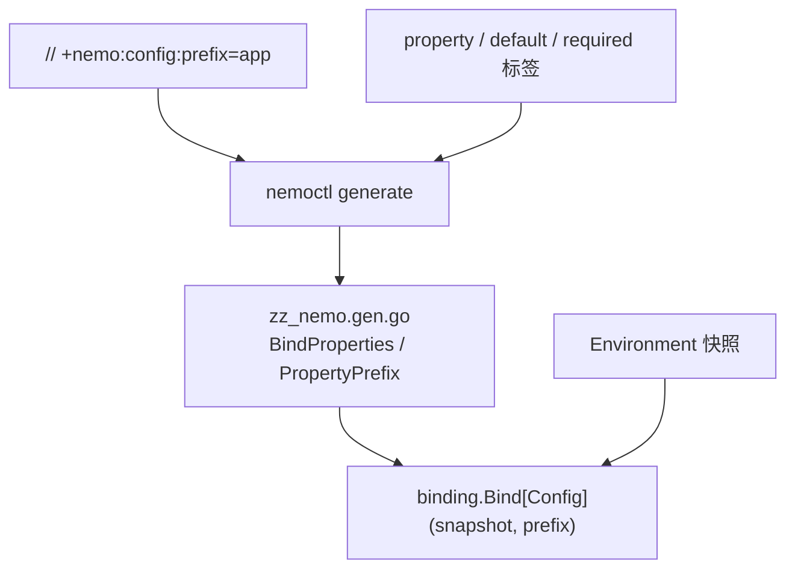

# 注释注解

Nemo 使用 controller-tools marker 语法选择需要生成配置绑定方法的类型。
`nemoctl` 在应用运行前读取这些注释和 Go 字段标签；运行时绑定调用生成的 Go 方法。



## 支持的注解 {#annotations}

| 注解 | 目标 | 参数 | 生成方法 |
| --- | --- | --- | --- |
| `+nemo:config:prefix=<prefix>` | 命名、非泛型的结构体声明 | 字符串；非空值必须是合法的 gosr 属性键 | `BindProperties` 和 `PropertyPrefix` |

这是 Nemo 唯一的注释注解。将它写入类型文档注释，放在声明的正上方：

```go
// +nemo:config:prefix=app
type Config struct {
    Name     string   `property:"name" required:"true"`
    Port     int      `property:"http.port" default:"8080"`
    Database Database `property:"database"`
    Local    string   `property:"-"`
}

type Database struct {
    Host string `property:"host" default:"localhost"`
}
```

`Name` 绑定 `app.name`，`Port` 绑定 `app.http.port`，`Database.Host` 绑定
`app.database.host`。生成器会处理本地嵌套结构体，无须为每个嵌套类型添加注解。
`Local` 跳过绑定；绑定已有目标时保留其原值。

显式传入空字符串，可生成默认绑定根路径的 Binder：

```go
// +nemo:config:prefix=""
```

## 多层前缀 {#multi-level-prefixes}

前缀可以包含多个点分段。以下声明将扁平的 Go 结构体绑定到
`company.platform.payment.database` 下的配置：

```go
// +nemo:config:prefix=company.platform.payment.database
type DatabaseConfig struct {
    Host string `property:"host" required:"true"`
    Port int    `property:"port" default:"5432"`
}
```

对应的 YAML：

```yaml
company:
  platform:
    payment:
      database:
        host: db.internal
        port: 6432
```

| 字段 | 完整属性键 | 绑定值 |
| --- | --- | --- |
| `Host` | `company.platform.payment.database.host` | `"db.internal"` |
| `Port` | `company.platform.payment.database.port` | `6432` |

生成后，`binding.Bind[DatabaseConfig](snapshot, "")` 使用注解中的前缀。
Go 结构体无须声明 `company`、`platform` 或 `payment` 层的字段；字段标签仍相对于选定前缀。

显式前缀也可以包含多层路径：
`binding.Bind[DatabaseConfig](snapshot, "tenant.eu.payment.database")` 读取
`tenant.eu.payment.database.host` 和 `tenant.eu.payment.database.port`。
前缀按原文匹配，`...` 不表示通配或省略。

## 字段标签 {#field-tags}

字段标签配置生成的 Binder，使用 Go 结构体标签语法，与注释注解分开声明。
类型注解决定是否为该类型生成绑定方法；仅有字段标签不会生成这些方法。

| 标签 | 作用 |
| --- | --- |
| 没有 `property` 标签 | 将完整 Go 字段名转为小写；`DatabaseURL` 映射为 `databaseurl` |
| `property:"http.port"` | 在绑定前缀下使用此相对属性键 |
| `property:"-"` | 排除该字段并保留原值 |
| `default:"8080"` | 属性缺失时解码此字符串 |
| `required:"true"` | 属性和默认值均未提供字段值时失败 |

`required` 仅接受 `true` 或 `false`。默认值适用于标量字段和标量列表，不能替代空字符串、
null 或非法输入。未导出字段必须使用 `property:"-"`。
转换规则、嵌套对象行为和支持的字段类型见[类型化绑定](binding.md)。

## 生成与绑定 {#generate-and-bind}

按[快速开始](quick-start.md)安装 `nemoctl` 后，在应用模块中运行：

```sh
nemoctl generate --roots ./...
nemoctl check --roots ./...
```

包含注解类型的选中包会生成 `zz_nemo.gen.go`，应将它与配置声明一起提交。
依赖包发布自己的生成方法；应用生成过程不写入依赖包或模块缓存。

获取环境快照后，在绑定调用中选择前缀：

| 调用 | 使用的前缀 |
| --- | --- |
| `binding.Bind[Config](snapshot, "")` | 注解中的 `app` |
| `binding.Bind[Config](snapshot, "service")` | 显式指定的 `service` |
| `config.BindProperties(snapshot, "")` | 根路径；直接调用不采用注解的默认前缀 |
| `config.BindProperties(snapshot, "service")` | 显式指定的 `service` |

修改注解、标签或参与绑定的字段后，需要重新生成。
`nemoctl check` 报告过期生成文件，不会重写文件。
包选择、输出所有权和失败行为见[代码生成](generation.md)。

## 使用 go:generate {#go-generate}

需要通过 Go 命令调用生成器时，在配置包的源码文件中添加标准 Go 指令：

```go
//go:generate nemoctl generate --roots .
```

然后运行：

```sh
go generate ./...
```

`PATH` 中必须能找到 `nemoctl`。该指令在所在包的目录中执行，并生成该包的绑定方法。
`go:generate` 属于 Go 指令；`go build` 和 `go test` 不会自动执行它。

## 放置位置与诊断 {#placement-and-diagnostics}

| 声明 | 生成器行为 |
| --- | --- |
| 在包、函数或字段上放置 `+nemo:config:prefix` | 拒绝位置不正确的注解 |
| 未知 `+nemo:` 名称，包括单独的 `+nemo:config` | 拒绝未知注解 |
| 为类型别名、泛型类型或非结构体类型添加注解 | 拒绝该声明 |
| 非法属性键、格式错误或重复的字段标签、基础类型字段的非法默认值 | 拒绝生成 |

注解只选择 `--roots` 匹配包中的类型，不会触发运行时包扫描。
移除包内最后一个注解后，需要重新生成，从生成文件中移除过期方法。
