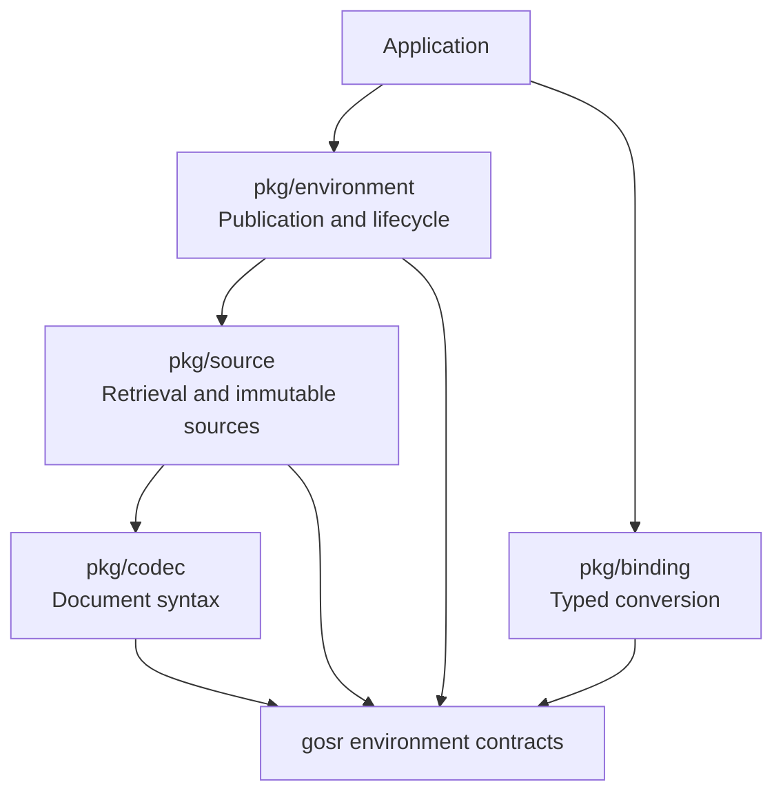
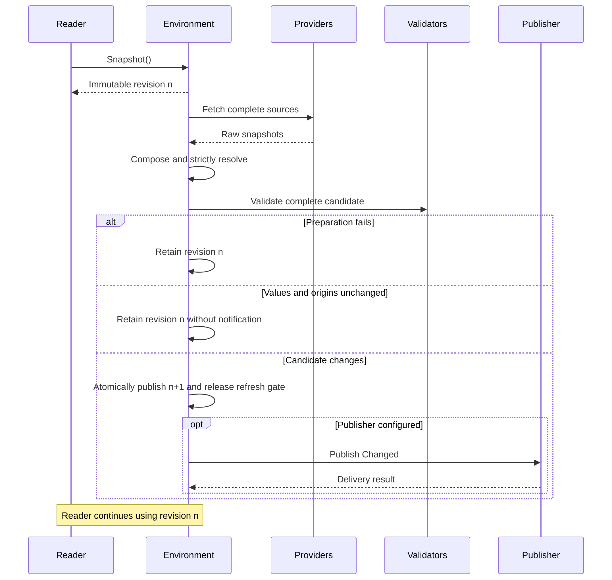
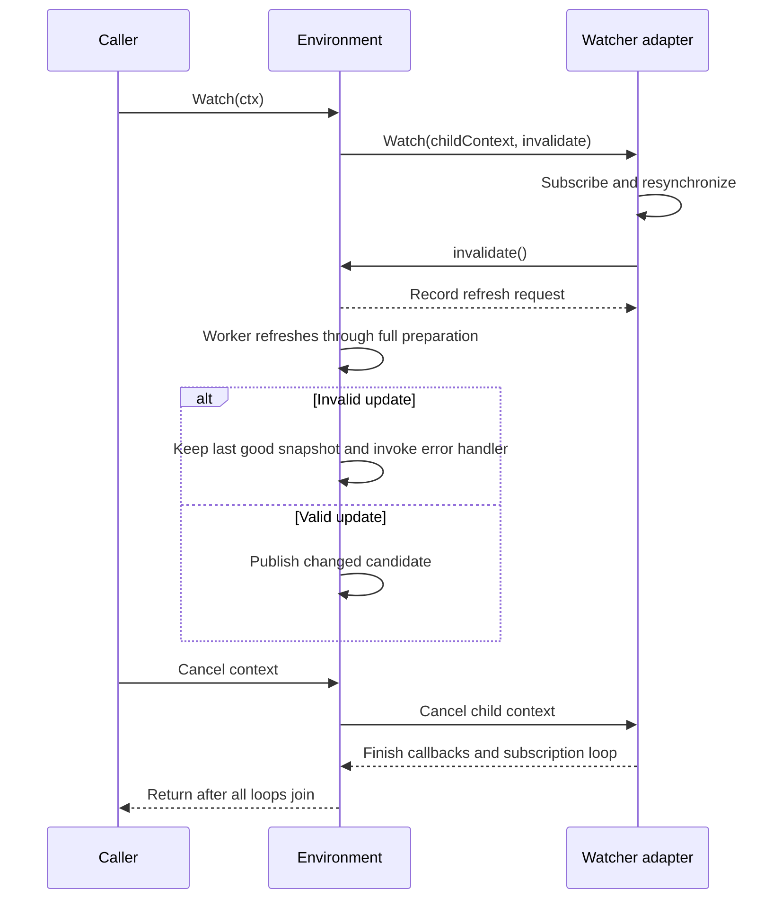

# Architecture

## Responsibilities and dependency direction

The gosr contracts define portable values, properties, profiles, snapshots and
`Bindable`. nemo supplies loading, normalization, resolution, publication and
static generation. The root `nemo.New` entry point returns the same Environment
type and accepts the same options as `pkg/environment`; source selection is explicit.

Transport and syntax are separate. A provider fetches a complete immutable source;
a decoder converts bytes without owning the transport. Property lookup has no
external I/O. Configuration-center SDKs belong in adapters. Source composition
and profile policy are described in
[configuration](configuration.md).

The compiler is a build-time subsystem. It reuses gosr mechanisms for package
loading, annotation parsing, pipelines, diagnostics, templates and staged output.
Annotation schemas, semantic models and module/output policy are defined by nemo.
`gosr/tools` is a separately versioned module. golayout provides Go formatting and
source-header handling.
The [generation guide](generation.md) describes the compiler pipeline and output policy.

## Refresh and snapshots

`environment.New` freezes bootstrap inputs, prepares revision 1 and returns only
after success. It emits no initial change event. `Refresh` serializes preparation
with a context-aware refresh gate. It replaces the current snapshot only after
all providers, resolution and validators succeed. Previously captured snapshots
remain valid.
Resolved value changes, property addition/removal and origin changes count as
changes; equal values and origins do not advance the revision.

Each Environment read captures the current snapshot independently. Capture one
`Snapshot()` for related reads or use `binding.Bind`, which pins a
`gosr.SnapshotProvider` once. Revisions identify publications within one Environment
instance; they do not order independent resources or provide distributed transactions.
A queued refresh returns on context cancellation without waiting for the current
writer. Provider operations must honor context cancellation. Validator callbacks run
synchronously; cancellation is checked after they return.
Cancellation concurrent with publication cannot undo an already committed
snapshot. An initialized Environment must not be copied.

Validators run during serialized preparation and must not call `Refresh` on the
same Environment. They can bind the candidate to enforce application constraints before
publication. Options configure bootstrap only; custom options must not retain and
later mutate the Environment.

## Notifications

`WithPublisher` injects a gosr `event.Publisher`. A changed commit synchronously
publishes `environment.Changed`, containing immutable `Old`/`New` snapshots and a
detached sorted `Keys` slice. Treat the event and its slice as read-only during
delivery.

Delivery happens outside the refresh gate. Publishers and watch error handlers
may read or refresh the Environment. Concurrent callbacks can overlap, so notification
arrival does not promise revision order. Inspect `New.Revision()` to identify a
commit. `environment.NotificationError` carries the committed revision and
preserves the delivery cause for `errors.Is` and `errors.As`. A delivery failure
does not roll back the snapshot.
No global event bus or background notification queue is created.

## Watch and configuration-center adapters

`Watch` is explicit and blocking. At most one watch group runs per Environment; only
providers implementing `source.Watcher` receive loops. With no watchers, it
returns immediately. A reload failure reaches `WithErrorHandler` when configured;
watching continues so a later valid update can recover. There is no background
retry policy. Any terminal watcher return cancels the group and all loops are
joined, together with the refresh worker, before `Watch` returns. Caller
cancellation returns its context error;
a terminal provider error is classified as a source failure.

Invalidations use one refresh worker and at most one pending refresh request.
Notifications during a refresh request a follow-up round; repeated signals
coalesce. The invalidation callback returns after signaling, so callers must
observe a snapshot revision or change event to establish publication. Manual
`Refresh` remains synchronous.

Adapters own network clients, shared subscriptions, reconnect behavior, freshness,
cache fallback and shutdown. Callbacks signal invalidation without carrying
mutable transport data, run outside transport locks and stop before the adapter's
`Watch` returns. On subscription startup, the adapter must signal an initial
invalidation or perform equivalent resynchronization so an update between the
initial fetch and subscription is not lost. Dependencies must honor their
concurrency, cancellation and lifecycle contracts.

Adapters supply configuration-center clients; Nemo does not include an SDK
adapter or rebuild application components after a configuration change. Planned
adapters and framework integration are listed in the
[roadmap](https://github.com/longxi-go/nemo/blob/main/docs/roadmap.md).
