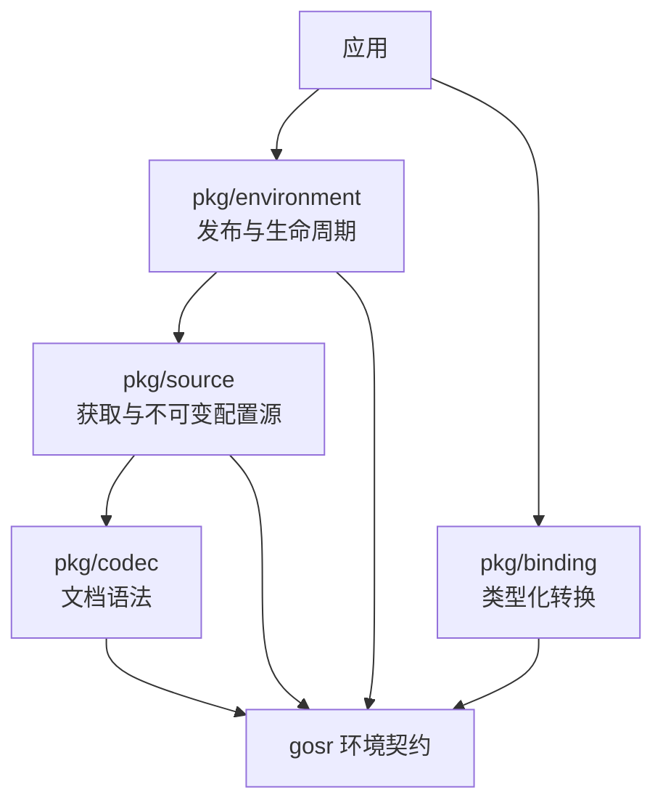
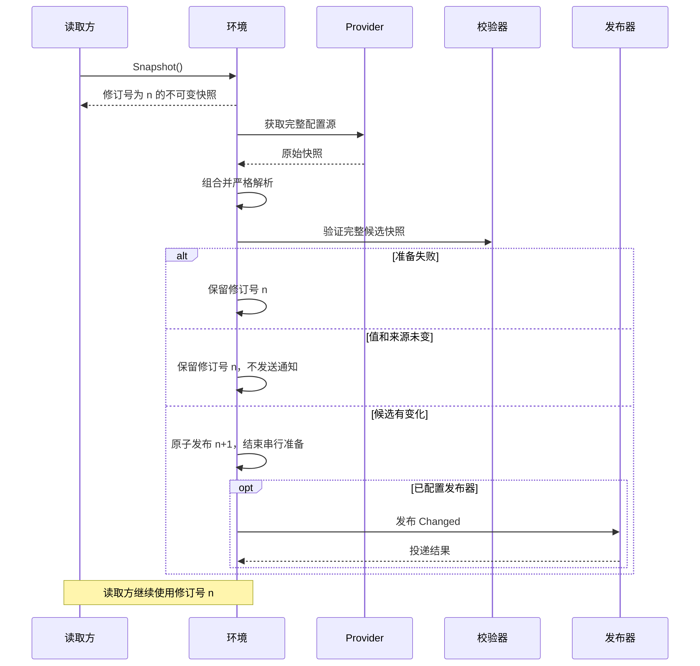
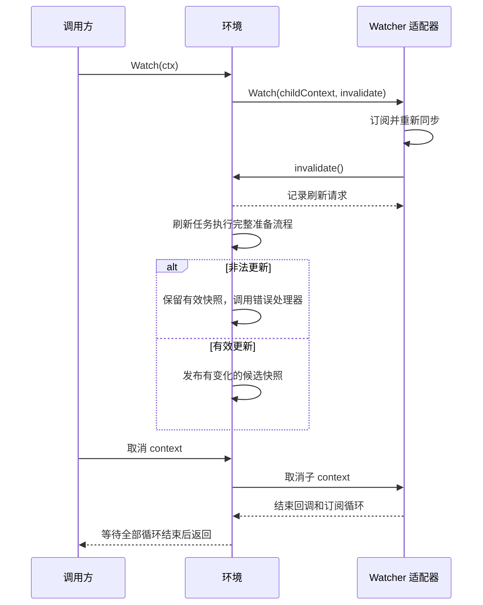

# 架构

## 职责与依赖方向

gosr 契约定义可移植的值、属性、Profile、快照和 `Bindable`。
nemo 提供加载、规范化、解析、发布和静态生成。
根包 `nemo.New` 入口与 `pkg/environment` 返回相同的 Environment 类型并接受相同的选项；配置源仍由调用方显式选择。

传输和语法分离。Provider 获取完整不可变配置源，解码器转换字节而不拥有传输资源。
属性查询不执行外部 I/O。配置中心 SDK 由适配器封装，不进入核心契约。
配置源组合和 Profile 策略见[配置语义](configuration.md)。

编译器是构建期子系统，复用 gosr 的包加载、注解解析、流水线、诊断、模板和分阶段输出机制。
注解模式、语义模型以及模块/输出策略由 nemo 定义。
`gosr/tools` 是独立版本化模块。golayout 提供 Go 格式化与源码文件头处理。
[代码生成指南](generation.md)说明编译器流水线与输出策略。

## 刷新与快照 {#refresh-and-snapshots}

`environment.New` 固定启动输入，准备修订号为 1 的快照，成功后才返回，不发送初始变更事件。
`Refresh` 串行准备候选快照，排队期间支持取消；仅在所有 Provider、解析和校验均成功后替换当前快照。
此前捕获的快照继续有效。已解析值变化、属性增删和来源变化都视为变更；值与来源均相同时不递增修订号。

每次直接读取环境都会独立捕获当前快照。关联读取应捕获同一 `Snapshot()`，
或使用会固定一次 `gosr.SnapshotProvider` 的 `binding.Bind`。
修订号标识同一 Environment 实例内的发布，不对独立资源排序，也不提供分布式事务。
已初始化的 Environment 不能复制。

排队的刷新可在 context 取消后返回，无须等待正在执行的刷新完成。Provider 应响应 context 取消。
校验器同步执行，环境在校验器返回后检查取消状态。取消与发布并发时，已提交的快照不会被撤销。

校验器在串行准备期间执行，不能对同一环境调用 `Refresh`。
它们可绑定候选快照，在发布前检查业务约束。选项只配置启动过程；自定义选项不能保留环境并在之后修改它。

## 通知

`WithPublisher` 注入 gosr `event.Publisher`。变更提交后同步发布 `environment.Changed`，
包含不可变的 `Old`/`New` 快照及与内部切片分离、有序的 `Keys`。
投递期间应将事件及键切片视为只读。

投递发生在刷新互斥区之外。发布器和监听错误处理器可以读取或刷新环境。
并发回调可能重叠，因此通知到达顺序不保证与修订号顺序一致；通过 `New.Revision()` 标识提交。
`environment.NotificationError` 携带已提交修订号，并保留投递错误供 `errors.Is` 和 `errors.As` 检查。
投递失败不回滚快照。
环境不会创建全局事件总线或后台通知队列。

## 监听与配置中心适配器

`Watch` 是显式阻塞调用。同一环境最多运行一组监听，仅为实现 `source.Watcher` 的 Provider 创建循环；
没有 Watcher 时立即返回。配置了 `WithErrorHandler` 时，重新加载错误传给该处理器；
监听继续运行，之后的有效更新可恢复。环境不提供后台重试策略。
任一 Watcher 终止返回都会取消整组监听；`Watch` 返回前等待所有循环及刷新任务结束。
调用方取消时返回其 context 错误，Provider 终止错误则分类为配置源失败。

适配器负责网络客户端、共享订阅、重连、数据时效性、缓存回退和关闭。
失效通知使用一个刷新任务和至多一个待处理信号，执行期间到达的通知会触发后续一轮，
重复通知合并。失效回调返回只表示信号已接收；应通过快照修订号或变更事件确认发布。
手动 `Refresh` 仍然同步返回。

回调只表达失效通知，不携带可变传输数据；回调在传输锁外执行，并在适配器的 `Watch` 返回前结束。
订阅启动时，适配器必须发出初始失效通知或执行等效重新同步，避免遗漏首次获取与订阅之间的更新。
依赖实现必须遵守并发、取消和生命周期契约。

配置中心客户端由适配器提供。Nemo 不包含 SDK 适配器，也不会在配置变更后自动重建应用组件。
适配器及框架集成计划见[路线图](https://github.com/longxi-go/nemo/blob/main/docs/roadmap.zh_CN.md)。
