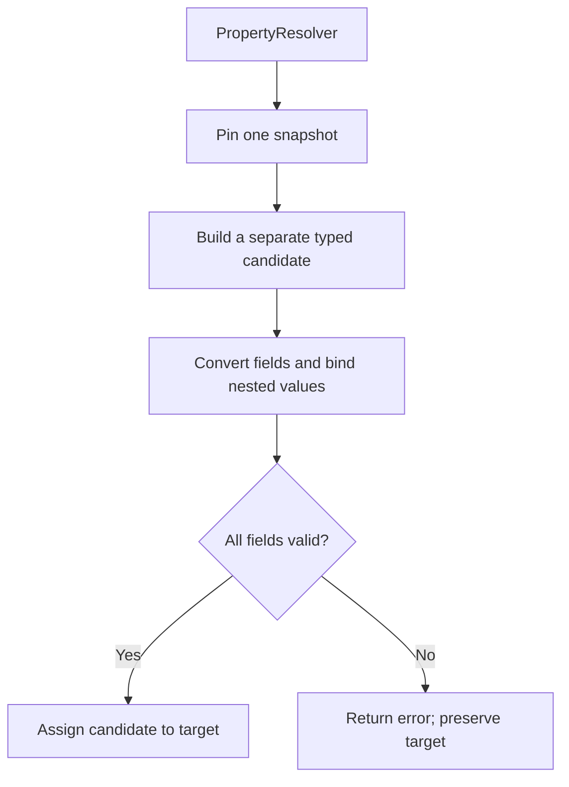
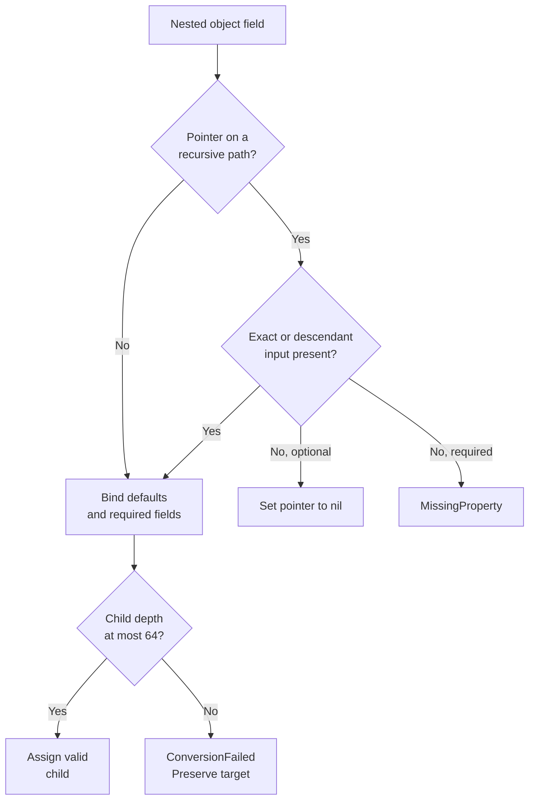

# Typed binding

## Binding transaction



`binding.Bind[T]` requires `*T` to implement gosr `Bindable` at compile time.
Generated methods and handwritten implementations share this contract. There is
no runtime type registry or reflective field traversal; the annotation compiler
performs type analysis before the application runs.

`binding.Bind[Config](resolver, prefix)` returns a newly bound value and pins a
snapshot when the resolver implements `gosr.SnapshotProvider`. Generated direct
`BindProperties` calls also pin such a provider. Pass a captured snapshot to bind
several objects against the same snapshot revision.

## Markers, prefixes and fields

The [annotation reference](annotations.md) covers comment syntax, placement and
generation commands. A configuration declaration combines a type annotation
with Go field tags:

```go
// +nemo:config:prefix=app
type Config struct {
    Name    string        `property:"name" required:"true"`
    Port    int           `property:"port" default:"8080"`
    Timeout time.Duration `property:"timeout" default:"5s"`
    Local   string        `property:"-"`
}
```

The marker supplies metadata through generated `PropertyPrefix()`. With an empty
prefix, `binding.Bind[Config](snapshot, "")` uses that metadata. Directly calling
`config.BindProperties(snapshot, "")` always binds the root. An explicit nonempty
prefix overrides the marker and must be a valid gosr key.

| Field tag | Semantics |
| --- | --- |
| No `property` tag | Lowercase the complete Go field name; `DatabaseURL` becomes `databaseurl` |
| `property:"database.url"` | Use this exact relative address under the binding prefix |
| `property:"-"` | Skip the field and preserve its current value |
| `default:"8080"` | Decode this string only when the property is missing |
| `required:"true"` | Fail when the property is absent and no default supplies it |

`required` accepts only `true` or `false`. Malformed or duplicate tags fail
generation. Unexported fields must be skipped. Missing optional scalar fields
become zero values; a default is not a fallback for empty, null or invalid input.
A required field can be supplied by a default. Defaults belong on scalar fields
or scalar lists, not nested structs or maps. Primitive defaults are checked during
generation; custom text defaults are parsed by their decoder during binding.
List defaults use one CSV record; an empty string denotes an empty list.

## Supported types

| Field shape | Conversion |
| --- | --- |
| Strings, booleans, signed/unsigned integers, floats and named scalar types | Typed converters; strings require string values; integer width/overflow is checked; floats must be finite |
| `time.Duration` | Go duration syntax such as `5s` |
| Custom scalar with pointer-receiver `encoding.TextUnmarshaler` | Parse a fresh typed value |
| Scalar pointers | Allocate replacement storage after successful conversion |
| Scalar slices | Decode a typed list or one CSV string record |
| `map[string]Scalar` | Decode an object, or assemble descendant addresses when the exact property is absent |
| Named or anonymous local nested structs and pointers | Generate typed helpers preserving tags and declared types |
| `[]T`, `[]*T`, `map[string]T`, `map[string]*T` for bindable objects | Generate typed allocation and binding loops; each element starts from zero |
| External nested structs or pointers | Require a published `BindProperties` method or `UnmarshalText` capability |

A map's exact property takes precedence over descendant assembly. Nested object
binding can project object members to dotted addresses; independently addressed
properties still take precedence. An exact nested object replaces the inherited
projection for its subtree; absent members do not survive from an older ancestor
projection. Child views do not mutate their parent view. Ambiguous object
projections fail rather than selecting an arbitrary field. Required nested fields
check exact or descendant presence, and nested scalar defaults still apply through
their generated helpers.

### Object presence and recursion



Nonrecursive optional nested struct pointers invoke the child binder even when
input is absent, applying defaults and required checks before allocation. A pointer
on a recursive type path is instead nil when optional input is absent, including
when the target previously held a pointer. Present empty objects instantiate the
child and apply its defaults; null and scalar inputs fail. Required recursive
pointers still require exact or descendant presence. Empty or missing recursive
collections terminate without constructing elements. Missing optional scalar
pointers remain nil unless a default supplies them.

`binding.MaxObjectDepth` is 64. In one generated private helper tree the root has
depth 0; each actual child object adds one, including collection elements.
Pointer and container wrappers add no depth. Both acyclic and recursive paths
are bounded. An external binder's root counts as one child; it enforces its own
internal traversal limit. Each generated public binding entry checks depth
independently; traversal within other packages does not contribute to that depth.

### Object collections

| Input | Object list | Object map |
| --- | --- | --- |
| Missing, optional | nil | nil |
| Explicit empty list/object | Non-nil empty slice | Non-nil empty map |
| Null or a scalar | Conversion error | Conversion error |
| Exact composite value | List elements must be objects | Members must be objects; literal member keys, including dots, are retained |
| Flat descendants | No implicit numeric/index syntax | Group at the first dot: `backends.east.port` selects member `east`, field `port` |

An exact map object takes precedence over flat descendants. Each collection element
has an isolated binding view: an unrelated parent key or sibling element cannot
supply its fields. `Resolve` within that view keeps the environment's absolute
reference semantics. Map elements bind in sorted key order.

The file codecs flatten object addresses before binding, so a flat map cannot
recover a dot that belonged to its original member name. Native JSON/YAML/TOML
lists support object lists. INI and properties have no object-list literal;
a custom decoder can supply a gosr list. Ordinary object lists do not accept CSV.
Scalar lists support CSV; custom scalar parsing uses `encoding.TextUnmarshaler`.

Element conversion errors retain the original source property and origin. For
example, an invalid `port` in the second element of `app.servers` reports
`Key=app.servers` and `Path=["[1]", "port"]`. Absolute-reference failures retain
their own key, origin and path. Wrapping does not modify the original error.

Generic configuration structs, bound embedded fields, interfaces, channels,
functions, arrays and nested containers are rejected. Scalar pointer elements
remain unsupported; object pointer elements are supported. Skipped fields can
retain types that would otherwise be unsupported.

## Target and reference ownership {#target-and-alias-ownership}

Generated methods return an error for a nil target or resolver. They prepare a
separate candidate and assign it to the target only after every field succeeds.
Bound maps, slices and pointers acquire replacement storage. Skipped fields,
including skipped fields inside local nested configuration, retain existing state.
The caller owns synchronization when binding an existing target.

External nested binders must implement the exact gosr `Bindable` method contract;
a function field with the same name does not qualify. External objects start from
a fresh zero-valued candidate and replace the field only after successful binding.
Their unbound members do not inherit old state. This prevents a successful external
binder from modifying old references before a later parent field fails; a shallow
copy cannot provide that guarantee. Handwritten binders must still honor their own
transaction contract and must not mutate external shared state.

Object collections also replace the entire collection. New elements start from
zero, so skipped members do not inherit values from the previous index or map key.
Skipping the collection field itself retains the original collection. Ordinary
local nested objects continue to preserve their skipped members.

## Validate before refresh publication

A typed validator can reject a candidate before it becomes the current snapshot:

```go
validate := func(snapshot gosr.Snapshot) error {
    config, err := binding.Bind[Config](snapshot, "")
    if err != nil {
        return err
    }
    if config.Port < 1 || config.Port > 65535 {
        return errors.New("port must be between 1 and 65535")
    }
    return nil
}
```

Pass this callback to `environment.WithValidator(validate)` during construction.
This fragment uses the `Config` above and imports `errors` and the gosr environment
package. Validators run inside serialized preparation and must not refresh the
same environment. Validation errors preserve the previous snapshot; binding an
already published snapshot later does not roll it back. See
[refresh semantics](architecture.md#refresh-and-snapshots).

## Composite input limits {#composite-input-admission}

`Nested`, `ListObjects` and `MapObjects` accept external resolvers, so they
independently apply default Value depth, node, byte and property budgets before
projection and collection allocation. Flat map grouping counts the whole input;
individually small members cannot bypass the aggregate budget. Generated object
depth has a separate limit. External binders must enforce their own internal
limits; each binding operation has independent counters.
