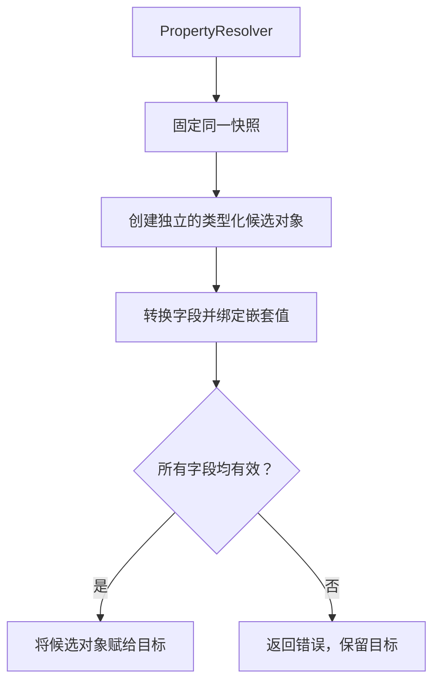
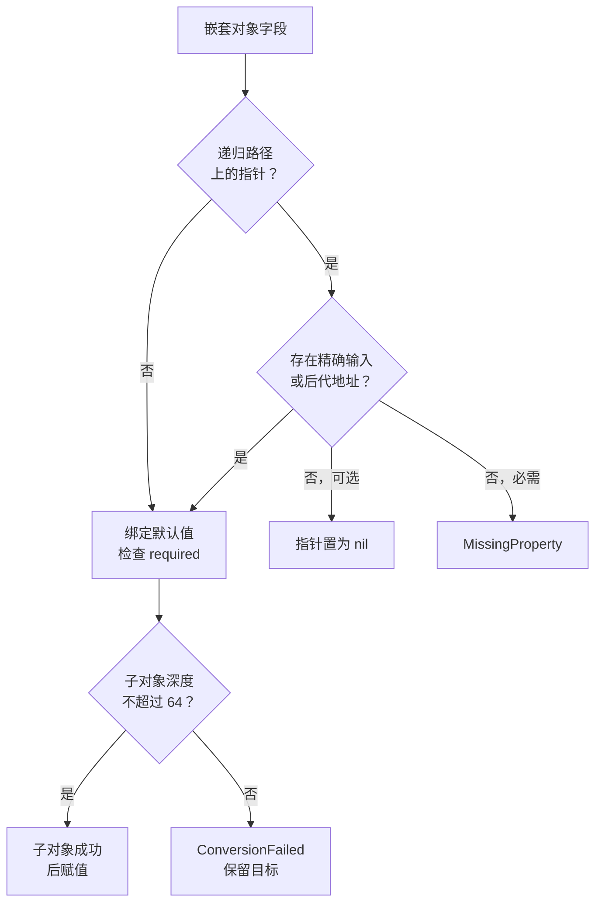

# 类型化绑定

## 绑定事务



`binding.Bind[T]` 在编译期要求 `*T` 实现 gosr `Bindable`。
生成方法和手写实现遵守同一契约。运行时不注册类型，也不通过反射遍历字段；
注解编译器在应用运行前完成类型分析。

`binding.Bind[Config](resolver, prefix)` 返回新绑定的值；属性解析器实现
`gosr.SnapshotProvider` 时会固定一次快照。直接调用生成的 `BindProperties` 方法也会固定一次快照。
多个对象需要使用相同配置时，传入同一个快照。

## 注解、前缀与字段

[注释注解指南](annotations.md)列出注释语法、放置位置和生成命令。
配置声明由类型注解和 Go 字段标签组成：

```go
// +nemo:config:prefix=app
type Config struct {
    Name    string        `property:"name" required:"true"`
    Port    int           `property:"port" default:"8080"`
    Timeout time.Duration `property:"timeout" default:"5s"`
    Local   string        `property:"-"`
}
```

注解通过生成的 `PropertyPrefix()` 提供元数据。
前缀为空时，`binding.Bind[Config](snapshot, "")` 使用该元数据；
直接调用 `config.BindProperties(snapshot, "")` 始终绑定根路径。
显式非空前缀覆盖注解，且必须是有效的 gosr 键。

| 字段标签 | 语义 |
| --- | --- |
| 没有 `property` 标签 | 将完整 Go 字段名转为小写；`DatabaseURL` 变为 `databaseurl` |
| `property:"database.url"` | 在绑定前缀下使用此精确相对地址 |
| `property:"-"` | 跳过字段并保留当前值 |
| `default:"8080"` | 仅在属性缺失时解码此字符串 |
| `required:"true"` | 属性缺失且没有默认值提供时失败 |

`required` 只接受 `true` 或 `false`。非法或重复标签导致生成失败；未导出字段必须跳过。
缺失的可选标量字段变为零值，默认值不能用于替代空、null 或非法输入。
必需字段可由默认值提供。默认值适用于标量字段或标量列表，不适用于嵌套结构体或 map。
基础类型默认值在生成时检查，自定义文本默认值在绑定时由解码器解析。
列表默认值使用一条 CSV 记录，空字符串表示空列表。

## 支持的类型

| 字段形态 | 转换 |
| --- | --- |
| 字符串、布尔值、有符号/无符号整数、浮点数及命名标量类型 | 使用类型化转换器；字符串要求字符串值；整数检查目标宽度和溢出；浮点数必须有限 |
| `time.Duration` | 使用 `5s` 等 Go 时长语法 |
| 指针接收者实现 `encoding.TextUnmarshaler` 的自定义标量 | 创建新值并解析 |
| 标量指针 | 转换成功后分配新存储 |
| 标量切片 | 解码类型化列表或一条 CSV 字符串记录 |
| `map[string]Scalar` | 解码对象；精确属性缺失时可由后代地址组装 |
| 命名或匿名的本地嵌套结构体及其指针 | 生成保留标签和声明类型的类型化辅助函数 |
| 对象的 `[]T`、`[]*T`、`map[string]T`、`map[string]*T` | 生成类型化分配和绑定循环，每个元素从零值开始 |
| 外部嵌套结构体或其指针 | 要求已发布 `BindProperties` 方法或 `UnmarshalText` 能力 |

map 的精确属性优先于后代地址组装。嵌套对象绑定可将对象成员投影为点分地址，
独立寻址的属性仍拥有优先级。精确的嵌套对象替换其子树继承的投影，
缺失成员不会从旧的祖先投影保留下来，子视图也不修改父视图。
对象投影存在歧义时失败，不任意选择字段。
必需嵌套字段检查精确地址或后代地址是否存在，嵌套标量默认值仍由生成的辅助函数应用。

### 对象存在性与递归



非递归的可选嵌套结构体指针在输入缺失时仍调用子 Binder，应用默认值并检查必需字段，成功后分配。
递归类型路径上的可选指针在输入缺失时置为 nil，即使目标原先持有指针。
存在的空对象会实例化子对象并应用默认值；null 或标量输入导致失败。
必需的递归指针仍要求存在精确输入或后代地址。缺失或为空的递归集合不构造元素，因此可终止遍历。
缺失的可选标量指针保持 nil，除非默认值提供了内容。

`binding.MaxObjectDepth` 为 64。同一生成辅助函数调用树中，根对象深度为 0，
每进入一个实际子对象加 1，包括集合元素；指针和容器本身不增加深度。
此限制同时适用于非递归与递归路径。外部 Binder 的根对象计为一个子对象，
但其内部遍历由自身约束。其他包的生成式公开入口独立计算深度，不累计其他包内部的遍历深度。

### 对象集合

| 输入 | 对象列表 | 对象 map |
| --- | --- | --- |
| 缺失，可选 | nil | nil |
| 显式空列表或对象 | 非 nil 空切片 | 非 nil 空 map |
| null 或标量 | 转换错误 | 转换错误 |
| 精确复合值 | 列表元素必须为对象 | 成员必须为对象，成员键原样保留，包括点 |
| 平铺后代地址 | 不隐式解释数字或索引语法 | 按首个点分组：`backends.east.port` 对应成员 `east`、字段 `port` |

精确 map 对象优先于平铺后代地址。每个集合元素使用隔离的绑定视图，
父级同名属性或相邻元素不能提供其字段。视图内的 `Resolve` 保留环境的绝对引用语义。
map 按成员键排序后绑定。

文件解码器在绑定前已将对象地址平铺，因此平铺 map 无法恢复原成员名中点的边界。
JSON/YAML/TOML 原生列表支持对象列表；INI 和 properties 没有对象列表字面量，
可由自定义解码器提供 gosr 列表。普通对象列表不接受 CSV；
标量列表支持 CSV，自定义标量解析使用 `encoding.TextUnmarshaler`。

元素转换错误保留原始源属性及来源。例如，`app.servers` 第二个元素的 `port` 非法时，
报告 `Key=app.servers`、`Path=["[1]", "port"]`。
绝对引用失败保留自身的键、来源和路径；错误包装不修改原错误。

泛型配置结构体、参与绑定的嵌入字段、接口、channel、函数、数组及嵌套容器不受支持。
标量指针元素不受支持，对象指针元素受支持。跳过的字段可以保留原本不支持的类型。

## 目标与引用所有权

目标或属性解析器为 nil 时，生成方法返回错误。它们准备独立候选对象，仅在全部字段成功后赋给目标。
参与绑定的 map、切片和指针使用新存储。跳过的字段保留现有状态，包括本地嵌套配置内的跳过字段。
绑定已有目标时，由调用方负责同步。

外部嵌套 Binder 必须实现精确的 gosr `Bindable` 方法契约，同名函数字段不构成实现。
外部对象从新的零值候选开始绑定，仅在成功后整体替换字段，其未绑定成员不继承旧状态。
因此，父对象后续字段绑定失败时，外部 Binder 不会通过旧引用修改原目标；浅复制不能隔离这些引用。
手写 Binder 仍须遵守自身事务契约，不得修改外部共享状态。

对象集合也采用整体替换。新元素从零值开始，其跳过成员不按旧索引或旧 map 键继承状态。
集合字段自身被跳过时保留整个原集合。普通本地嵌套对象继续保留其跳过成员。

## 在刷新发布前验证

类型化校验器可以在候选快照发布前拒绝它：

```go
validate := func(snapshot gosr.Snapshot) error {
    config, err := binding.Bind[Config](snapshot, "")
    if err != nil {
        return err
    }
    if config.Port < 1 || config.Port > 65535 {
        return errors.New("port must be between 1 and 65535")
    }
    return nil
}
```

构造环境时，将回调传给 `environment.WithValidator(validate)`。
此片段使用前述 `Config`，并导入 `errors` 与 gosr 环境包。
校验器在串行准备期间执行，不能刷新同一环境。
验证失败保留原快照；之后对已发布快照执行绑定失败不会回滚该快照。
详见[刷新与快照](architecture.md#refresh-and-snapshots)。

## 复合输入限制 {#_9}

`Nested`、`ListObjects` 和 `MapObjects` 接受自定义 Resolver，因此在投影及集合分配前
独立检查默认的 Value 深度、节点数、字节数和属性数限制。平铺 map 分组累计输入总量，
即使各成员单独未超限，集合总量仍受限制。生成对象的遍历深度单独检查。
外部 Binder 须自行限制内部处理量；各次绑定操作独立统计。
