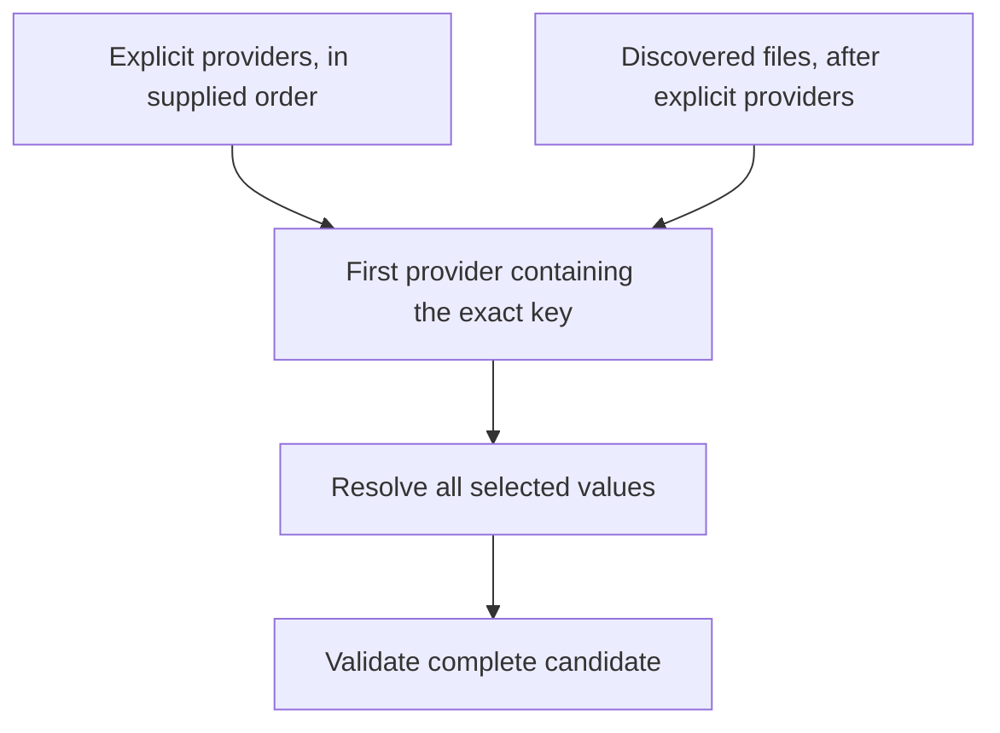
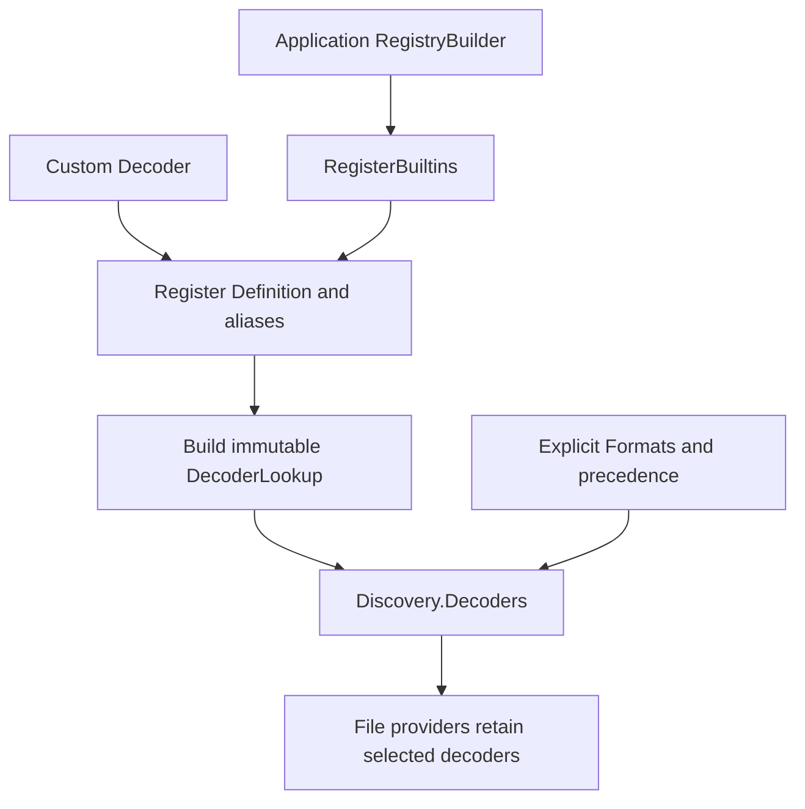
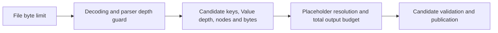

# Configuration semantics

## Sources and precedence



`environment.WithProviders` appends providers in highest-first order. Every
provider returns a complete immutable `gosr.PropertySource`; source names must be
unique within one candidate. Raw `Lookup` and resolved environment reads perform
no external I/O. `source.NewMap` and `source.NewProperties` copy caller maps.
Keys returned by sources and environments are sorted, detached slices.

Keys are exact and case-sensitive. They are atomic addresses: an object at `app`
does not remove a separately addressed `app.port`. No implicit case conversion,
OS source or file discovery occurs in `environment.New`.

| Property state | Effect |
| --- | --- |
| Missing | Lower sources may supply it; a placeholder or field default may apply |
| Empty string | Present; overrides lower sources and does not select a default |
| Null | Present; overrides lower sources, but fails scalar placeholder use and typed binding |
| Invalid selected value | Candidate resolution or typed conversion fails; no fallback to a lower value |

Preparation fetches providers in order, including providers whose keys are
shadowed. A provider error fails the candidate even when a higher provider supplies
the same keys. Resolution then
checks every selected value, including values the application has not read.

## Map aliases

`github.com/longxi-go/nemo/pkg/maptypes` names frequently used map types:

| Alias | Equivalent type |
| --- | --- |
| `Map[K, V]` | `map[K]V` |
| `StringMap[T]` | `map[string]T` |
| `IntMap[T]` | `map[int]T` |
| `StringBoolMap` | `map[string]bool` |
| `StringBytesMap` | `map[string][]byte` |
| `StringAnyMap` | `map[string]any` |
| `ValueMap` | `map[string]gosr.Value` |
| `PropertyMap` | `map[string]gosr.Property` |

`gosr` denotes `github.com/longxi-go/gosr/pkg/environment`.
`StringMap` and `IntMap` name the key type; callers select the value type.
`Map` accepts any comparable key. `StringBytesMap` stores byte slices;
`StringAnyMap` represents parser objects before normalization to `gosr.Value`.
These are Go type aliases, so raw maps and existing function signatures remain
compatible. The aliases retain normal mutable map semantics and do not validate
keys, copy entries or synchronize access. `source.NewMap` and
`source.NewProperties` still validate inputs and copy entries into immutable sources.
Aliases do not expand binding support: generated map fields still require string
keys and supported element types.

## Providers and decoding

| API | Retrieval policy |
| --- | --- |
| `source.Static(properties)` | Reuses an immutable property source |
| `source.NewFile(name, path, decoder, optional)` | Reads and decodes the full file on each fetch |
| `source.NewOS(name, prefix)` | Captures the process environment on each fetch |
| `source.Provider` | Custom transport returning a complete immutable source |

Optional files ignore only a not-exist error. Permissions, directories and malformed
documents still fail. File reads and decoding check cancellation before and after
synchronous work; an in-flight OS read or decoder call cannot be interrupted.
Built-in providers start no background loops.

OS prefix matching is case-sensitive. Matching names lose the prefix, become
lowercase and replace each underscore with a dot. For example, prefix `APP_`
maps `APP_DATABASE_HOST` to `database.host`. Values remain strings, including
empty strings. Two names mapping to one key cause an error. An empty prefix
includes the entire process environment.

### Decoder registries {#decoder-catalogs}



`codec.ForFormat` selects `yaml`, `yml`, `json`, `toml`, `properties` or `ini`.
To discover another format, register a `codec.Definition` in an application-owned
`RegistryBuilder`, call `Build`, and pass the resulting registry through
`source.Discovery.Decoders`. A nil registry uses the built-ins. `RegisterBuiltins`
is optional; an application can allow only its selected formats.

```go
builder := codec.NewRegistryBuilder()
if err := codec.RegisterBuiltins(builder); err != nil {
    return err
}
if err := builder.Register(codec.Definition{
    Name: "acme",
    Aliases: []string{"conf.dsl"},
    Decoder: applicationDecoder,
}); err != nil {
    return err
}
discovery := source.Discovery{
    Formats: []string{"conf.dsl", "yaml"},
    Decoders: builder.Build(),
}
```

`applicationDecoder` implements `codec.Decoder`. It owns syntax; the provider
owns file or network resources. `DecoderFunc` adapts a decoding function.
Registration, including the built-in batch, is atomic. Duplicate names or aliases
are errors. Names use ASCII letters/digits, underscores and hyphens, optionally
separated into dot-delimited segments; each segment starts with a letter or digit.
Lookup ignores case, while discovery uses the exact extension spelling in
`Formats` for filesystem paths. Registering a format does not add it to discovery;
the order in `Formats` determines precedence, not registration order.

Builders support serial bootstrap. `Build` copies the name mapping, so later
registrations cannot affect existing registries or providers. It does not clone
decoder state: injected decoders and custom lookup implementations must support
concurrent use when shared. Nil decoders and nil `DecoderFunc` values are rejected;
custom typed-nil implementations own their nil-receiver behavior. No global
mutable registry or automatic `init` registration is used.

### Format rules

| Format | Scalars and duplicate declarations |
| --- | --- |
| YAML/YML | Native scalar types; duplicate checks and merge-key precedence follow the YAML parser |
| JSON | Native scalar types; duplicate members are rejected before map construction |
| TOML | Native scalar types; duplicate declarations are rejected by the TOML parser |
| Java properties | Strings; the last declaration for a key wins; parser interpolation is disabled |
| INI | Strings; repeated sections merge and the last key declaration wins; parser interpolation is disabled |

Objects flatten into dotted keys; arrays retain typed objects and lists. Empty
objects remain atomic values. Ambiguous flattened addresses and nonstring YAML
keys are rejected. Decoding rejects nonfinite numbers and nesting beyond 64 levels.
Untagged YAML integer text outside `int64`/`uint64` is rejected before
floating-point rounding. Explicit finite `!!float` values retain float semantics;
quoted numeric text remains a string. YAML/TOML dates become RFC3339Nano strings. Distinct INI
section/key pairs that produce the same flattened address are rejected.

## Resource limits {#resource-admission}



`limits.Default()` returns the default policy. `environment.WithLimits(policy)`
sets the environment's fixed resource limits and passes them to file providers
created by discovery. Independent file providers use
`source.NewFileWithOptions(name, path, decoder, source.FileOptions{Limits: policy})`;
built-in decoder registries use `codec.NewBuiltinRegistry(policy)`. Convenience
constructors select defaults. Explicit zero or negative limits are invalid.
Discovery selects defaults when its policy is omitted.

| Resource | Default limit |
| --- | --- |
| Bytes per document | 8 MiB |
| Sources, including optional candidates | 256 |
| Properties per source and after merge | 10,000 |
| Value depth | 64 |
| Total candidate Value nodes | 100,000 |
| Raw candidate bytes | 16 MiB |
| Resolved candidate bytes | 16 MiB |

The data root has depth zero; each member value or list element adds one. YAML
document nodes, key nodes and alias wrappers add no depth. Built-in parsers retain
an independent 64-level safety ceiling; raising a Value budget does not remove
that guard. Dots in addresses do not add Value depth.

The node limit counts Value instances across all selected properties. The byte
limit counts UTF-8 property keys, object member names and scalar text. Repeated
references count at each occurrence. Raw and resolved budgets are
separate and exclude previous snapshots.

Expanded strings count toward the output limit before each buffer append,
including nested defaults. A cached dependency counts once as a property and
once per occurrence in a referencing value. YAML preflight checks shared aliases by node and depth rather than expanding every
reference path; the decoder retains its own alias-ratio checks.

File reads are bounded and accept regular files, including regular symlink
targets, while rejecting special files. Cancellation cannot interrupt arbitrary
OS calls. Allocations already made by custom providers, including their `Keys`
arrays, remain implementation-owned; environment limits apply to subsequent
validation and processing. `limits.ExceededError` provides numerical diagnostics
through `errors.As` and matches `gosr.ResolutionLimit` through `errors.Is`, without
printing input values. Rejected candidates preserve the prior snapshot.

## Placeholders

| Syntax | Meaning |
| --- | --- |
| `${key}` | Require a present scalar property |
| `${key:default}` | Use the default only when `key` is missing |
| `${key:${other:fallback}}` | Resolve a nested default |
| `\${key}` | Produce the literal `${key}` |

String values expand recursively; lists and objects resolve their contained
values without losing their types. A referenced string, boolean or number is
rendered as scalar text. Null, lists and objects cannot be substituted into text.
An empty scalar remains empty and does not trigger a default.

Malformed syntax is rejected even in an unused default branch; references in an
unused default are not evaluated. Missing references, cycles and invalid operands
fail candidate preparation. Expansion depth is limited to 64 and each expanded
string to 1 MiB. Captured expansion depth still counts when a resolved reference
is reused. Escaped output is not expanded again during later lookup.

## Profiles and file discovery

Profiles are bootstrap inputs. `WithProfiles` sets unique active names;
`WithDefaultProfiles` sets fallback names, using `default` when unspecified or
empty. Names begin with an ASCII letter or digit and continue with letters,
digits, dots, underscores or hyphens. `AcceptsProfiles` ORs names and `!name`
predicates and validates every predicate; an empty predicate list returns false.
This is not a general boolean expression language.

`environment.WithDiscovery(source.Discovery{...})` uses the environment's configured active
profiles, or defaults when no active profiles exist. Its `Discovery.Profiles`
must be empty. Use `source.Discover` directly to select profiles independently.
Discovered providers are appended after all explicit providers.

Discovery defaults are path `.`, name `application` and format `yml`. It selects
`<name>-<profile>.<format>` and `<name>.<format>` as optional files, in this order:

1. Later profiles precede earlier profiles; all profile files precede base files.
2. Within each profile/base group, later directories precede earlier directories.
3. Names and formats follow their listed order.

For profiles `[dev, local]`, paths `[config, secrets]`, one name and one format,
`secrets/application-local.yml` has the highest discovered precedence and
`config/application.yml` the lowest. Repeated lexical paths are deduplicated;
source names use `file:` followed by the native cleaned absolute path. These are
opaque identities, not file URIs; `Origin.Resource` retains the native path.
Discovery does not resolve symlinks or collapse filesystem case aliases. Remote properties
cannot silently change the frozen profiles or discovery policy.

## Diagnostics

Errors use gosr classifications and retain causes for `errors.Is`/`errors.As`.
Built-in printable decoder, source and conversion diagnostics omit configuration
payloads. Unwrapped parser or custom-converter causes can contain sensitive data;
log classification and provenance according to the application's disclosure policy.
