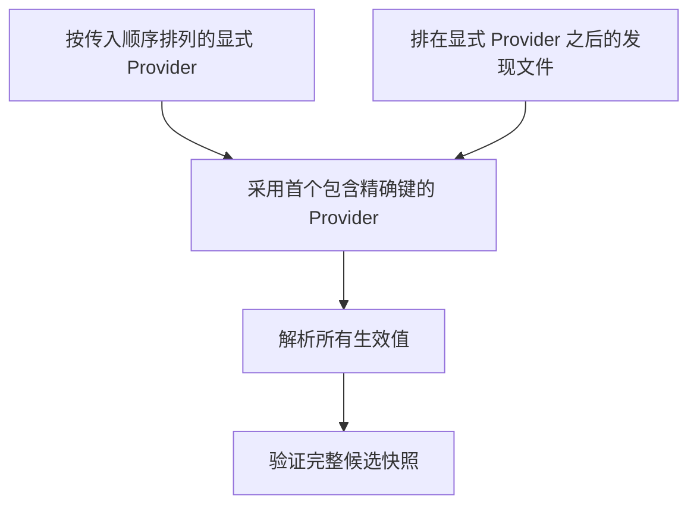
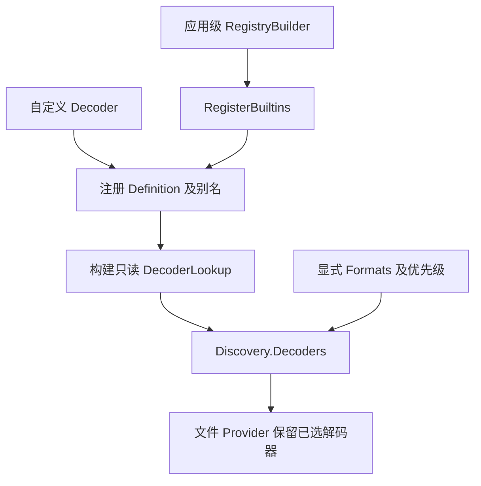

# 配置语义

## 配置源与优先级



`environment.WithProviders` 按高优先级在前的顺序追加 Provider。
每个 Provider 返回完整且不可变的 `gosr.PropertySource`；同一候选快照内的配置源名称必须唯一。
原始 `Lookup` 和环境中的已解析读取均不执行外部 I/O。
`source.NewMap` 与 `source.NewProperties` 复制调用方 map；配置源和环境返回的键列表有序且与内部切片分离。

键按原文精确匹配，区分大小写；每个键是独立地址：`app` 上的对象不会删除单独寻址的 `app.port`。
`environment.New` 不会隐式转换大小写、加入 OS 配置源或发现文件。

| 属性状态 | 行为 |
| --- | --- |
| 缺失 | 可由较低优先级来源提供；占位符或字段默认值可能适用 |
| 空字符串 | 视为已存在；覆盖低优先级来源，不选用默认值 |
| Null | 视为已存在；覆盖低优先级来源，但不能用于标量占位符或类型化绑定 |
| 非法生效值 | 候选解析或类型转换失败，不回退到较低优先级值 |

准备候选快照时按顺序获取 Provider，包括键被覆盖的 Provider。
即使更高优先级 Provider 已提供相同键，其他 Provider 的错误仍会使候选失败。
随后解析所有生效值，包括应用尚未读取的值。

## Map 别名

`github.com/longxi-go/nemo/pkg/maptypes` 为常用 Map 类型提供简写：

| 别名 | 等价类型 |
| --- | --- |
| `Map[K, V]` | `map[K]V` |
| `StringMap[T]` | `map[string]T` |
| `IntMap[T]` | `map[int]T` |
| `StringBoolMap` | `map[string]bool` |
| `StringBytesMap` | `map[string][]byte` |
| `StringAnyMap` | `map[string]any` |
| `ValueMap` | `map[string]gosr.Value` |
| `PropertyMap` | `map[string]gosr.Property` |

`gosr` 指 `github.com/longxi-go/gosr/pkg/environment`。
`StringMap` 和 `IntMap` 按键类型命名，值类型由调用方指定。
`Map` 接受任意可比较的键类型；`StringBytesMap` 存储字节切片；
`StringAnyMap` 表示转换为 `gosr.Value` 之前的解析器对象。
这些类型均使用 Go 类型别名，可与原始 Map 及既有函数签名互换。
别名保留普通 Map 的可变语义，不校验键、不复制条目，也不提供并发同步。
`source.NewMap` 与 `source.NewProperties` 仍负责校验输入并复制条目，构造不可变配置源。
别名不扩展绑定支持范围：生成式 Map 绑定仍要求字符串键和受支持的元素类型。

## Provider 与解码

| API | 获取策略 |
| --- | --- |
| `source.Static(properties)` | 复用不可变属性源 |
| `source.NewFile(name, path, decoder, optional)` | 每次获取时完整读取并解码文件 |
| `source.NewOS(name, prefix)` | 每次获取时捕获进程环境变量 |
| `source.Provider` | 自定义传输，返回完整不可变配置源 |

可选文件只忽略文件不存在错误；权限、目录和非法文档仍然导致失败。
文件读取和解码在同步工作前后检查取消；已经开始的 OS 读取或解码器调用本身不能被中断。
内置 Provider 不启动后台循环。

OS 前缀匹配区分大小写。匹配名称移除前缀后转为小写，每个下划线替换为点。
例如前缀 `APP_` 将 `APP_DATABASE_HOST` 映射为 `database.host`。
值保持字符串，包括空字符串；两个名称映射到同一键时产生错误。
空前缀会包含整个进程环境。

### 解码器注册表 {#_3}



`codec.ForFormat` 选择 `yaml`、`yml`、`json`、`toml`、`properties` 或 `ini`。
发现其他格式时，在应用级 `RegistryBuilder` 注册 `codec.Definition`，调用 `Build`，
再通过 `source.Discovery.Decoders` 传入所得注册表。注册表为 nil 时使用内置格式。
`RegisterBuiltins` 是可选的，应用也可只允许自己选择的格式。

```go
builder := codec.NewRegistryBuilder()
if err := codec.RegisterBuiltins(builder); err != nil {
    return err
}
if err := builder.Register(codec.Definition{
    Name: "acme",
    Aliases: []string{"conf.dsl"},
    Decoder: applicationDecoder,
}); err != nil {
    return err
}
discovery := source.Discovery{
    Formats: []string{"conf.dsl", "yaml"},
    Decoders: builder.Build(),
}
```

`applicationDecoder` 实现 `codec.Decoder`，负责文档语法；Provider 负责文件或网络资源。
`DecoderFunc` 可适配解码函数。单次注册和内置批量注册均为原子操作；名称或别名重复会返回错误。
名称使用 ASCII 字母、数字、下划线和连字符，可由点分为多段，每段以字母或数字开头。
注册表查找忽略大小写，但文件发现按 `Formats` 中的原始扩展名构造路径。
注册格式不会自动将其加入发现列表；优先级取决于 `Formats` 顺序，与注册顺序无关。

Builder 用于串行初始化。`Build` 复制名称映射，后续注册不影响已有注册表或 Provider。
此操作不复制解码器内部状态：共享的解码器和自定义查找实现必须支持并发使用。
nil 解码器及 nil `DecoderFunc` 会被拒绝；自定义类型的 nil 指针实现须自行处理接收者。
不使用全局可变注册表或自动 `init` 注册。

### 格式规则

| 格式 | 标量与重复声明 |
| --- | --- |
| YAML/YML | 原生标量类型；重复声明检查和合并键优先级遵循 YAML 解析器 |
| JSON | 原生标量类型；构造 map 前拒绝重复成员 |
| TOML | 原生标量类型；TOML 解析器拒绝重复声明 |
| Java properties | 字符串；同一键采用最后一次声明；禁用解析器插值 |
| INI | 字符串；合并重复 section，同一键采用最后一次声明；禁用解析器插值 |

对象展开为点分键，数组保留类型化对象和列表，空对象保留为独立值。
存在歧义的展开地址与非字符串 YAML 键均被拒绝。
解码拒绝非有限数和超过 64 层的嵌套。
未标注的 YAML 整数文本超出 `int64`/`uint64` 时，在浮点舍入发生前拒绝；显式有限
`!!float` 按浮点语义处理，引号中的数字保留为字符串。
YAML/TOML 日期转换为 RFC3339Nano 字符串。
不同 INI section/key 组合展开为相同地址时会被拒绝。

## 资源限制 {#_5}


`limits.Default()` 返回默认限制。`environment.WithLimits(policy)` 在构造时固定配置环境的资源限制，
并传给该环境创建的 Discovery 文件源。独立文件源使用
`source.NewFileWithOptions(name, path, decoder, source.FileOptions{Limits: policy})`，
内置解码器注册表使用 `codec.NewBuiltinRegistry(policy)`。便捷构造器采用默认限制。显式指定零或负数无效；
Discovery 未指定限制时采用默认值。

| 维度 | 默认上限 |
| --- | --- |
| 单文档字节 | 8 MiB |
| 配置源数（含可选文件候选） | 256 |
| 每源及合并后属性数 | 10,000 |
| Value 深度 | 64 |
| 候选 Value 总节点 | 100,000 |
| 原始候选字节 | 16 MiB |
| 解析后候选字节 | 16 MiB |

数据根深度为 0；进入成员值或列表元素加 1。YAML 文档节点、键节点和别名包装不计层。
内置解析器另有 64 层深度上限，提高 Value 深度限制不会改变解析器的上限。地址中的点不增加
Value 深度。节点数累计所有生效属性中的 Value 节点；字节数累计属性键名、对象成员名和
标量文本的 UTF-8 字节。重复引用按出现次数计数。原始值与解析结果分别统计，不累计旧快照。

展开文本在每次追加到输出缓冲区前计入字节总数，包括嵌套默认值产生的文本。
缓存依赖作为属性统计一次，并在引用它的值中按出现次数统计。YAML 预检按节点与深度
检查共享别名，避免重复展开每条引用路径；解码器仍执行自身的别名比例检查。

文件读取限制字节数，接受普通文件及符号链接指向的普通文件，拒绝特殊文件。
取消不能强制中断任意 OS 调用。Environment 的限制适用于后续校验与处理，
无法约束自定义 Provider 已完成的内存分配，包括 `Keys` 返回的切片。

限额错误可通过 `errors.As` 获取 `limits.ExceededError`，并通过 `errors.Is`
匹配 `gosr.ResolutionLimit`；错误不包含配置原文。候选被拒绝时保留原快照。

## 占位符

| 语法 | 含义 |
| --- | --- |
| `${key}` | 要求属性存在且为标量 |
| `${key:default}` | 仅在 `key` 缺失时使用默认值 |
| `${key:${other:fallback}}` | 解析嵌套默认值 |
| `\${key}` | 生成字面量 `${key}` |

字符串递归展开；列表和对象递归解析其包含的值，并保留类型。
引用的字符串、布尔值或数字呈现为标量文本；null、列表和对象不能替换到文本中。
空标量保持为空，不触发默认值。

未使用的默认分支也会检查语法，但不求值其中的引用。
引用缺失、循环引用和非法操作数均使候选准备失败。
展开深度上限为 64，每个展开字符串上限为 1 MiB。
复用已解析引用时，仍计算原有展开深度；转义输出不会在后续读取时再次展开。

## Profile 与文件发现

Profile 是启动输入。`WithProfiles` 设置已激活的 Profile 名称并去重；`WithDefaultProfiles` 设置后备名称，
未指定或为空时使用 `default`。名称以 ASCII 字母或数字开头，后续可包含字母、数字、点、下划线和连字符。
`AcceptsProfiles` 对名称和 `!name` 条件执行逻辑或，并验证全部条件；空条件列表返回 false。
它不支持通用布尔表达式。

`environment.WithDiscovery(source.Discovery{...})` 使用环境配置的已激活 Profile，
未激活 Profile 时使用默认值；其中 `Discovery.Profiles` 必须为空。
需要独立选择 Profile 时直接使用 `source.Discover`。
发现的 Provider 追加在所有显式 Provider 之后。

发现策略的默认路径为 `.`，名称为 `application`，格式为 `yml`。
按以下优先级选择可选文件 `<name>-<profile>.<format>` 和 `<name>.<format>`：

1. 后列出的 Profile 优先于先列出的 Profile；所有 Profile 文件优先于基础文件。
2. 在每个 Profile/基础文件组内，后列出的目录优先于先列出的目录。
3. 名称和格式按其列表顺序排列。

对于 Profile `[dev, local]`、路径 `[config, secrets]`、一个名称和一种格式，
`secrets/application-local.yml` 在发现文件中优先级最高，`config/application.yml` 最低。
重复的词法路径会去重；配置源名称为 `file:` 前缀加本机格式的规范化绝对路径。
该名称是不透明标识，不是文件 URI；`Origin.Resource` 保留本机路径。
文件发现不解析符号链接，也不合并文件系统中的大小写别名。
远程属性不能隐式改变固定的 Profile 或发现策略。

## 诊断

错误使用 gosr 分类，保留原因供 `errors.Is`/`errors.As` 检查。
内置解码器、配置源和转换诊断的可打印形式省略配置内容。
解包后的解析器或自定义转换器错误可能包含敏感信息；应根据应用的信息披露策略记录分类和来源。
