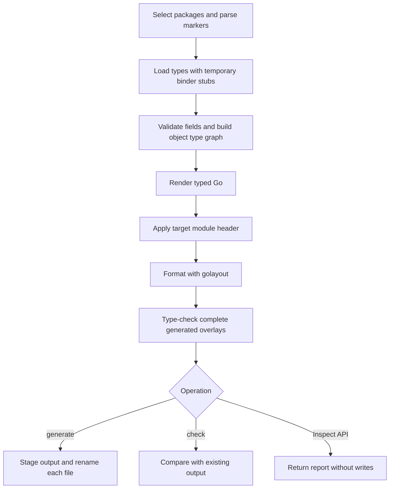

# Code generation

## Compiler pipeline



The generator emits ordinary Go `BindProperties` and `PropertyPrefix` methods.
The [annotation reference](annotations.md) lists the accepted annotations and tags
and shows how to declare configuration types.
Temporary in-memory stubs permit first-generation callers of `binding.Bind`
without hiding unrelated type errors. Complete generated overlays must type-check
before any output is written. The object graph identifies recursive pointer paths
independently of traversal order; templates emit typed helpers and collection loops.
Unsupported declarations produce diagnostics;
supported field shapes are listed in [typed binding](binding.md).

Annotated types must be named, non-generic struct declarations, not type aliases.
`+nemo:config:prefix` markers belong on those configuration types. Unknown nemo
markers, markers on packages/functions/fields and other unattached markers fail
with positional annotation diagnostics. Integer defaults for `int`, `uint` and
`uintptr` are checked against the target package's architecture, including `GOARCH`.

## Command line

Install `github.com/longxi-go/nemo/cmd/nemoctl` as described in the
[quick start](quick-start.md). The CLI provides two commands:

```sh
nemoctl generate --dir /path/to/application --roots ./...
nemoctl check --dir /path/to/application --roots ./...
```

| Option | Meaning |
| --- | --- |
| `--dir` | Working directory for module/package loading; defaults to the current directory |
| `--roots` | Go package patterns; defaults to `.`; repeatable or comma-separated |

For example, `--roots ./config --roots ./service/...` selects two package sets.
Flags follow the command; positional arguments are rejected. On success the CLI
prints the selected output paths and exits zero. Invalid arguments, analysis
errors, stale output in `check`, or output failures produce a nonzero exit status.

The application must already have resolvable modules and checksums. Package
loading uses readonly module mode; generation does not install dependencies or
edit `go.mod`/`go.sum`. Resolve imports with normal Go module commands before
running `nemoctl`. The Go command must be available on `PATH`.

## Output ownership and failure behavior

Each selected package with annotated types uses `zz_nemo.gen.go`. Commit that
file with the package that owns the types. A dependency publishes its own generated
methods; consumer generation does not write to dependencies or the module cache.
Keep the generator and runtime module on the same version.

Only the standard nemo-generated header on a regular file establishes ownership.
Authored files and symlinks at the output path are refused by generation, checking
and inspection. Removing the last marker
replaces owned output with a package-only generated file after overlay validation
has removed obsolete methods. Until regeneration, `check` rejects those stale
methods rather than accepting a file that still compiles.

The optional `codequality/HEADER` in the target module supplies the output owner's
source notice. The generated marker remains first. nemo's own copyright is not
copied into application output. Formatting uses the pinned golayout dependency
before validation and output.

Semantic failures write nothing. Successful generation stages files and publishes
each with atomic rename; a filesystem failure can leave earlier packages updated.
There is no cross-package filesystem transaction. Rerun generation after correcting
the error, then use `check` to establish output consistency. `check` performs the
same analysis and generated type validation without writing source or module
metadata. `Inspect` also validates without writing; it reports prospective output
rather than requiring existing files to match.

## Go API

`pkg/codegen` exposes `Run`, `Inspect`, `Options`, `Report` and `File` for tools that
need caller-owned context and structured output paths/types. `Options.Check`
selects freshness checking for `Run`; `Options.Dir` and `Options.Roots` use the same
selection policy as the CLI.
