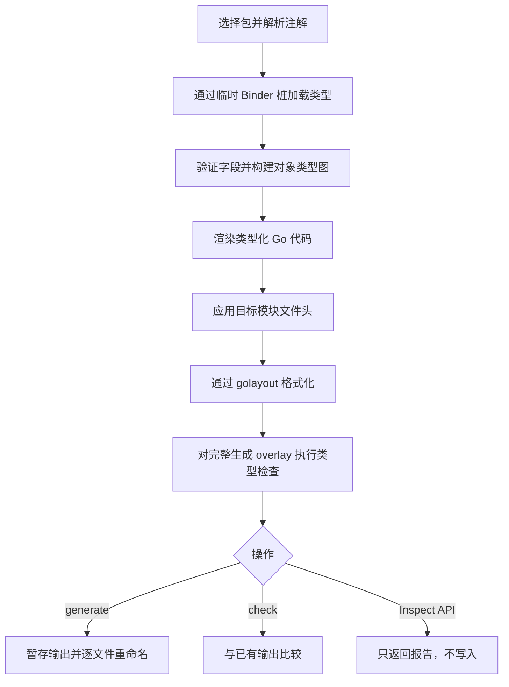

# 代码生成

## 编译流水线



生成器输出普通 Go `BindProperties` 与 `PropertyPrefix` 方法。
[注释注解指南](annotations.md)列出支持的注解和标签，以及配置类型的声明方式。
临时内存桩允许首次生成时调用 `binding.Bind`，但不会掩盖其他类型错误。
完整生成 overlay 必须通过类型检查后才写入输出。不支持的声明产生诊断，
支持的字段形态见[类型化绑定](binding.md)。

注解类型必须是命名、非泛型的结构体声明，不能是类型别名。
`+nemo:config:prefix` 注解应附着于这些配置类型。
未知 nemo 注解、包/函数/字段上的注解及其他未附着注解均产生带位置的注解诊断。
`int`、`uint` 与 `uintptr` 的整数默认值按目标包架构检查，包括 `GOARCH` 设置。

对象类型图识别完整的递归指针路径，不依赖遍历顺序；模板生成类型化辅助函数和集合循环。

## 命令行

按[快速开始](quick-start.md)安装 `github.com/longxi-go/nemo/cmd/nemoctl`。
CLI 提供两个命令：

```sh
nemoctl generate --dir /path/to/application --roots ./...
nemoctl check --dir /path/to/application --roots ./...
```

| 选项 | 含义 |
| --- | --- |
| `--dir` | 模块/包加载的工作目录，默认为当前目录 |
| `--roots` | Go 包模式，默认为 `.`；可重复或使用逗号分隔 |

例如 `--roots ./config --roots ./service/...` 选择两组包。
标志位于命令之后，不接受位置参数。成功时 CLI 输出选中的输出路径，退出状态为零。
非法参数、分析错误、`check` 发现过期输出或输出失败均返回非零状态。

应用必须已具备可解析的模块和校验和。包加载使用只读模块模式；
生成器不安装依赖，也不编辑 `go.mod`/`go.sum`。
运行 `nemoctl` 前应使用常规 Go 模块命令解析导入，`PATH` 中必须能找到 Go 命令。

## 输出所有权与失败行为

包含注解类型的选中包使用 `zz_nemo.gen.go`。
将该文件与类型所属的包一同提交；依赖包发布自己的生成方法，消费方生成器不写入依赖或模块缓存。
生成器与运行时模块应使用相同版本。

只有普通文件上的标准 nemo 生成文件头能确立输出所有权。
`generate`、`check` 和 `Inspect` 均拒绝输出路径上的手写文件或符号链接。
移除最后一个注解后，overlay 验证先移除过时方法，再将已有生成输出替换为仅含包声明的生成文件。
重新生成之前，即使旧方法仍能编译，`check` 也会拒绝这些过期方法。

目标模块可选的 `codequality/HEADER` 提供输出所有者的源码声明，生成标记始终位于首行。
nemo 自身的版权声明不会复制到应用的生成文件。
验证与写入前使用固定依赖版本的 golayout 格式化。

语义错误不写入文件。生成成功时先暂存文件，再通过原子重命名逐文件发布；
文件系统失败可能使前面的包已经更新，不提供跨包文件系统事务。
修复错误后重新生成，再用 `check` 检查输出一致性。
`check` 执行相同分析和生成类型验证，不写入源码或模块元数据。
`Inspect` 也执行验证且不写入，但它报告预期输出，不要求现有文件与其一致。

## Go API

`pkg/codegen` 提供 `Run`、`Inspect`、`Options`、`Report` 和 `File`，
供需要调用方 context 及结构化输出路径/类型的工具使用。
`Options.Check` 为 `Run` 选择生成文件一致性检查；
`Options.Dir` 和 `Options.Roots` 与 CLI 使用相同选择策略。
