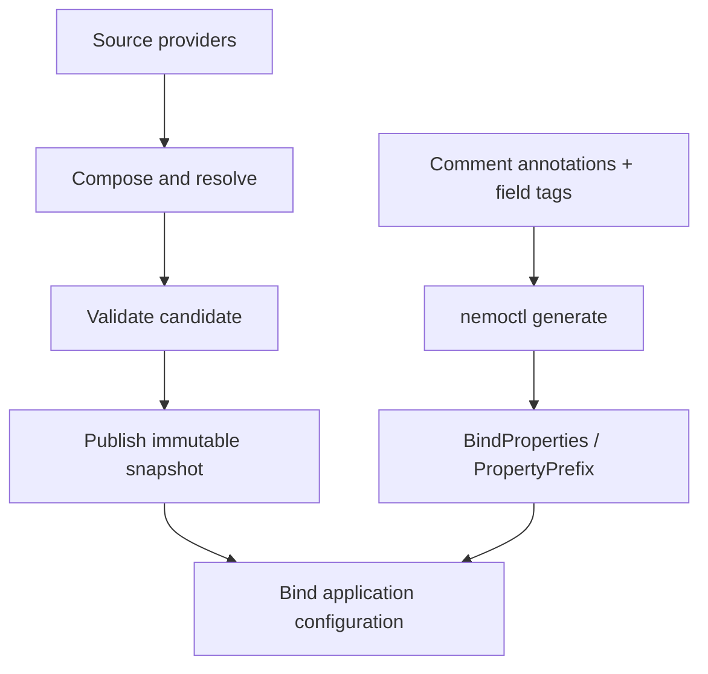

# nemo configuration environments

nemo generates typed configuration binding from comment annotations and field tags.
Its environment implements the [gosr environment contracts](https://longxi-go.github.io/gosr/contracts/environment/)
with explicit providers, strict placeholder resolution and immutable revision snapshots.

[Quick start](quick-start.md){ .md-button .md-button--primary }
[Comment annotations](annotations.md){ .md-button }

Providers own retrieval; decoders own syntax. The environment owns candidate
preparation and publication. Binding captures a snapshot from `SnapshotProvider`
inputs before reading fields, so all fields use the same snapshot.

| Guide | Contents |
| --- | --- |
| [Quick start](quick-start.md) | Install nemo, generate binding methods and run an example |
| [Comment annotations](annotations.md) | Annotation reference, field tags, prefix selection and generation |
| [Configuration](configuration.md) | Sources, formats, precedence, placeholders and profiles |
| [Typed binding](binding.md) | Tags, supported types, conversion and target ownership |
| [Generation](generation.md) | `nemoctl`, compiler validation and output ownership |
| [Architecture](architecture.md) | Package boundaries, refresh, notifications and watch lifecycle |
| [Development](development.md) | Repository tooling, quality gates and documentation |

A failed candidate preserves the previous snapshot. A notification failure occurs
after commit and does not revert configuration.

Source and releases are available in the [GitHub repository](https://github.com/longxi-go/nemo)
and [release history](https://github.com/longxi-go/nemo/releases).
