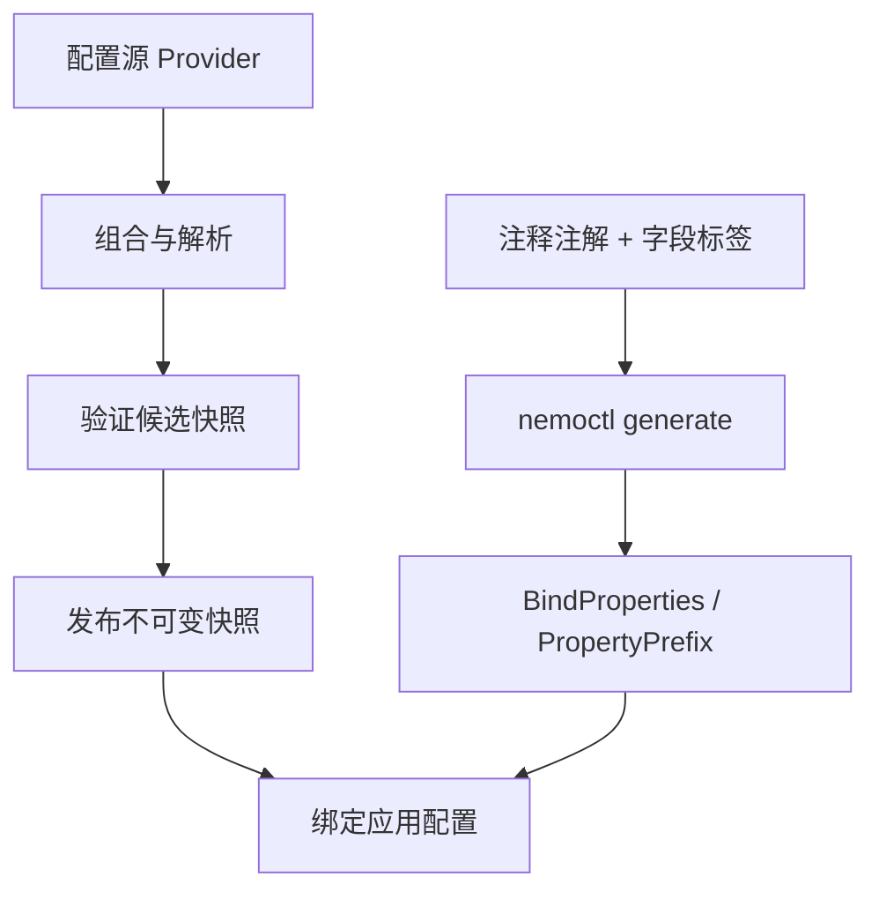

# nemo 配置环境

nemo 根据注释注解和字段标签生成类型化配置绑定方法。
其配置环境实现 [gosr 环境契约](https://longxi-go.github.io/gosr/zh/contracts/environment/)，
提供显式 Provider、严格占位符解析和带修订号的不可变快照。

[快速开始](quick-start.md){ .md-button .md-button--primary }
[注释注解](annotations.md){ .md-button }

Provider 负责获取数据，解码器负责语法。环境负责准备和发布候选快照。
绑定在读取字段前获取 `SnapshotProvider` 提供的快照，使全部字段使用同一快照。

| 指南 | 内容 |
| --- | --- |
| [快速开始](quick-start.md) | 安装 nemo、生成绑定方法并运行示例 |
| [注释注解](annotations.md) | 注解清单、字段标签、前缀选择和生成步骤 |
| [配置语义](configuration.md) | 配置源、格式、优先级、占位符和 Profile |
| [类型化绑定](binding.md) | 标签、支持的类型、转换和目标所有权 |
| [代码生成](generation.md) | `nemoctl`、编译器验证和输出所有权 |
| [架构](architecture.md) | 包边界、刷新、通知和监听生命周期 |
| [开发指南](development.md) | 仓库工具、质量门禁和文档 |

候选快照失败时保留原快照。通知错误发生在提交之后，不会回滚配置。

源码和发布版本分别见 [GitHub 仓库](https://github.com/longxi-go/nemo)
与[发布记录](https://github.com/longxi-go/nemo/releases)。
