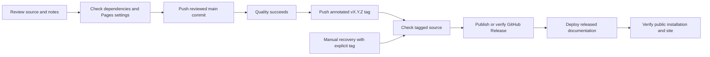

# Releases

[English](releases.md) | [简体中文](releases.zh_CN.md)



## Preparation

Use a stable `vX.Y.Z` tag and maintain its English notes in
`docs/releases/vX.Y.Z.md`, headed `# nemo vX.Y.Z`. The Go directive in `go.mod`
is the language minimum; the tag determines the module version. A v2 release
requires a versioned module path and a corresponding release-policy update.

The module must resolve through published dependencies without workspace or
module replacements. `gosr` and `gosr/tools` have independent tags; the latter's
module version `vX.Y.Z` corresponds to its repository tag `tools/vX.Y.Z`.

Run from the repository root with Go, Python 3.12, Bash, Git, uv,
golangci-lint and an authenticated GitHub CLI:

```sh
make setup
make check docs-build build
make preflight-release TAG=vX.Y.Z
```

The preflight validates notes and module identity, checks stable upstream
Releases and reads GitHub repository settings. Go's module checks independently
verify dependency checksums. The preflight does not change remote settings.

In **Settings → Pages**, select **GitHub Actions**. In **Settings → Environments →
github-pages → Deployment branches and tags**, permit root release tags with a
`v*` **tag** rule. A branch rule named `v*` does not permit tags. Keep any other
reviewed environment protection rules. These settings belong to each repository;
copying workflow files does not copy them.

## Publication and verification

Push the reviewed commit and wait for its Quality workflow to pass before
creating an annotated tag. The Release workflow validates and checks the exact
tagged source, publishes the maintained notes as a stable Release. GitHub selects Latest
using the explicit `make_latest=legacy` policy (creation date and semantic
version); only a release selected as Latest calls Pages. Pages runs serially and
checks Latest again before deployment, refusing a release superseded during its build. Pages checks out that tag and requires its published
stable Release. Branch and pull-request workflows build documentation without
deploying it. A manual Pages deployment also requires the explicit current Latest stable tag.

The publisher reuses an existing Release only when its tag, title, notes and stable
status match the tagged source. It refuses conflicting content and a tag that no
longer points to the checked commit. Latest lookup allows six attempts, five seconds
apart, for HTTP 404, 429 and server errors or a still-visible older Latest selection.
Authentication and permission errors fail immediately. An uncertain creation request
is not repeated automatically.

After the workflow succeeds, verify both documentation languages and test an
independent consumer with `GOWORK=off`, no `replace` directives and a fresh module
cache. Check `go get github.com/longxi-go/nemo@vX.Y.Z`, runtime configuration
loading, generated binding, and `go install github.com/longxi-go/nemo/cmd/nemoctl@vX.Y.Z`.
Run `go mod verify` with checksum verification enabled. A successful source test
or GitHub Release does not establish public module availability.

## Recovery

After correcting repository settings or the workflow, run **Release → Run workflow**
from the reviewed `main` revision and supply the existing stable tag. The equivalent
CLI command is:

```sh
gh workflow run release.yml --repo longxi-go/nemo --ref main -f release_tag=vX.Y.Z
```

The selected workflow revision supplies the publication scripts. Validation resolves
the tag to a commit; every source check and the published notes use that exact commit.
The run verifies or creates the Release and deploys Pages only if it is Latest.
It does not replace an existing Release or move the tag. The original failed run
remains in Actions history; the recovery produces a new run.

Never move or reuse a published tag. Corrections to released library or CLI source
require a new release version. A workflow correction can verify and deploy an
existing version through the recovery entry point above.
