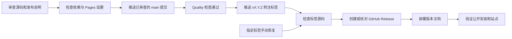

# 发布

[English](releases.md) | [简体中文](releases.zh_CN.md)



## 发布准备

使用稳定版本标签 `vX.Y.Z`，并在 `docs/releases/vX.Y.Z.md` 中维护英文发布说明，
标题为 `# nemo vX.Y.Z`。`go.mod` 的 Go 指令声明最低语言版本，模块版本由标签决定。
发布 v2 前，需要调整模块路径和相应的发布规则。

模块必须通过已发布的依赖独立解析，不使用 workspace 或模块替换。
`gosr` 和 `gosr/tools` 分别发布；后者的模块版本 `vX.Y.Z` 对应仓库标签
`tools/vX.Y.Z`。

准备 Go、Python 3.12、Bash、Git、uv、golangci-lint 和已认证的 GitHub CLI，
在仓库根目录执行：

```sh
make setup
make check docs-build build
make preflight-release TAG=vX.Y.Z
```

预检查验证发布说明和模块身份，检查上游稳定 Release，并读取 GitHub 仓库设置。
Go 模块检查独立验证依赖校验和。预检查不会修改远程设置。

在 **Settings → Pages** 选择 **GitHub Actions**。
在 **Settings → Environments → github-pages → Deployment branches and tags**
中添加 `v*` **标签**规则，允许根模块版本标签部署。名称为 `v*` 的分支规则不能代替标签规则。
保留其他经过审查的环境保护规则。这些设置按仓库独立保存，复制工作流文件不会复制设置。

## 发布与验证

推送已审查的提交，等待该提交的 Quality 工作流通过后，再创建附注标签。
Release 工作流验证并检查标签对应的源码，使用维护的发布说明创建稳定 Release。GitHub 使用显式的 `make_latest=legacy` 策略，
根据创建时间和语义版本选择 Latest，只有被选为 Latest 的版本才调用 Pages。
Pages 工作流串行执行，并在部署前再次检查 Latest；如果构建期间已有新版本取代当前版本，则拒绝部署。Pages 检出该标签，并要求其稳定 Release 已发布。
分支和拉取请求只构建文档，不部署站点；手动部署 Pages 也必须指定当前 Latest 稳定版本标签。

发布器仅在标签、标题、发布说明和稳定状态均与标签源码一致时复用已有 Release；
已发布内容不一致，或标签不再指向已检查的提交时，直接报错。Latest 查询最多尝试六次，
间隔五秒，处理 HTTP 404、429、服务端错误以及仍返回旧 Latest 的情况。
认证和权限错误立即失败。创建请求的结果不确定时，不自动重复创建。

工作流通过后，检查两种语言的文档，并使用独立调用工程验证公开版本。
调用工程应设置 `GOWORK=off`，不包含 `replace` 指令，并使用新的模块缓存。
验证 `go get github.com/longxi-go/nemo@vX.Y.Z`、运行时配置加载、生成式绑定，
以及 `go install github.com/longxi-go/nemo/cmd/nemoctl@vX.Y.Z`。
保持校验和验证开启，并执行 `go mod verify`。
源码测试通过或 GitHub Release 已创建，均不能代替公开模块安装验证。

## 恢复发布

修正仓库设置或工作流后，在 **Release → Run workflow** 中选择经过审查的 `main`，
填写已有的稳定版本标签。也可执行：

```sh
gh workflow run release.yml --repo longxi-go/nemo --ref main -f release_tag=vX.Y.Z
```

发布脚本来自选定的工作流版本。验证阶段将标签解析为提交，全部源码检查和发布说明均使用
该提交。工作流核对或创建 Release，仅在该版本为 Latest 时部署 Pages；不会覆盖已有
Release，也不会移动标签。原失败记录保留在 Actions 历史中，恢复操作产生一次新的运行。

不得移动或复用已发布标签。修正已发布的库或 CLI 源码需要新的发布版本；
仅修正工作流时，可以通过上述恢复入口核对并部署已有版本。
