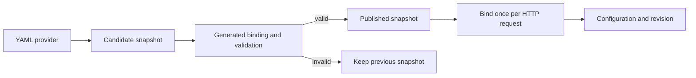

# Nemo with Gin

[English](README.md) | [简体中文](README.zh_CN.md)

This standalone example uses Nemo's generated binding in a Gin handler. Gin is
declared only in this nested module. It does not add a Web adapter to Nemo.



## Configuration and request handling

`Config` uses `+nemo:config:prefix=company.platform.service`. The generated
`BindProperties` method binds the nested YAML at that prefix into a Go value.
The `required` tags reject absent values; `validateSnapshot` also checks the
service name and address before the Environment publishes a candidate.

`GET /configuration` captures one snapshot, binds `Config`, and returns its fields
with that snapshot's revision. A successful `Refresh` affects later binds. It
does not mutate existing structs or snapshots. A failed refresh leaves the
published revision unchanged.

The address accepts a nonempty host and a numeric port from 1 through 65535,
including bracketed IPv6 hosts. No DNS lookup or TCP listener is started.
The example deliberately exposes only its nonsecret demonstration fields.

## Run

Requires the Go version declared in `go.mod`. From this directory:

```sh
make run
make check
```

`make run` loads `testdata/application.yaml` and dispatches a request through the
real Gin router with `httptest`. The JSON response contains `alpha`,
`127.0.0.1:8081` and revision `1`. Gin may also print its debug-mode startup log.
An application serving TCP can pass `Application.Router()` to `http.Server`.

After editing annotated configuration types:

```sh
make format
make generate
make check
```

The compiler version comes from this module's Nemo requirement. Generation uses
the published compiler, and generated source remains with the example.
`make check` validates the nested module explicitly: standalone dependency
resolution, generated output, formatting, source notices, vet, tests, race
detection and lint. Root `go test ./...` does not include nested modules.

Tests cover nested YAML, missing and invalid configuration, explicit rebinding,
failed-refresh preservation, coherent concurrent reads and canceled requests.
