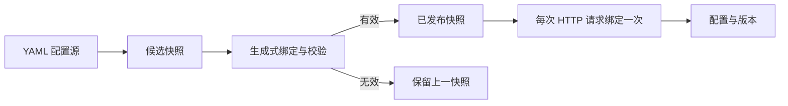

# Nemo 与 Gin 集成

[English](README.md) | [简体中文](README.zh_CN.md)

本示例在 Gin 处理器中使用 Nemo 生成的配置绑定代码。Gin 依赖仅声明在当前嵌套
模块中，不为 Nemo 增加 Web 适配器。



## 配置与请求处理

`Config` 使用 `+nemo:config:prefix=company.platform.service`。生成的
`BindProperties` 方法将 YAML 中该多层前缀下的属性绑定为 Go 值。`required`
标签检查属性是否存在；Environment 发布候选快照前，`validateSnapshot` 还会
校验服务名称和地址。

`GET /configuration` 获取一个快照，绑定 `Config`，并返回配置字段及该快照的
版本号。`Refresh` 成功后，后续绑定读取新配置，已经绑定的结构体和持有的快照
保持不变。刷新失败不会改变已发布版本。

地址必须包含非空主机名和 1 至 65535 的数字端口，支持方括号包围的 IPv6 地址。
校验不执行 DNS 查询，也不启动 TCP 监听。响应仅包含示例中的非敏感字段。

## 运行

使用 `go.mod` 声明的 Go 版本，在当前目录执行：

```sh
make run
make check
```

`make run` 读取 `testdata/application.yaml`，通过 `httptest` 向真实 Gin 路由
发送请求。JSON 响应包含 `alpha`、`127.0.0.1:8081` 和版本号 `1`。Gin 在调试
模式下还可能输出启动日志。需要监听 TCP 的应用可将 `Application.Router()`
传给 `http.Server`。

修改带注解的配置类型后执行：

```sh
make format
make generate
make check
```

生成命令从当前模块的 Nemo 依赖读取编译器版本，使用已发布的编译器，生成代码
与示例源码一同保留。`make check` 单独检查当前嵌套模块的依赖解析、生成代码、
格式、文件头、vet、测试、竞态和 lint。根模块的 `go test ./...` 不包含嵌套模块。

测试覆盖多层 YAML、缺失与非法配置、显式重新绑定、刷新失败保留旧版本、并发
读取一致性和请求取消。
